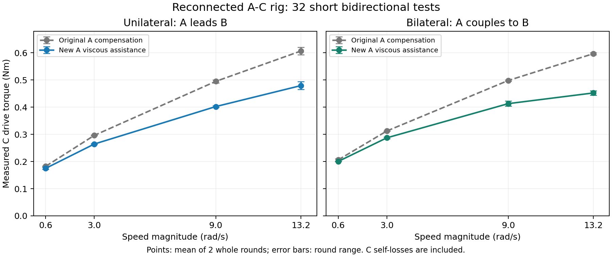

# A/C 重接后：新粘性补偿的单边、双边真机对照（2026-11-06）

**完成32轮有效真机试验。3–13.2 rad/s 下，两种模式的两方向、两次配对均出现减阻；13.2 rad/s 时单边降低20.98%，双边降低24.20%。** 低速0.6 rad/s的整轮均值也下降，但双边某方向有反例，不能认定所有低速拖动都更轻。

测试结束后三轴均已失能、无活动来源、反馈新鲜，控制器回到 `bilateral`，`extra_viscous_a` 恢复测试前的0。新系数和验证协议另行保存，**没有覆盖生产标定注册表，也没有把新参数留在运行默认值中**。

## 实际阻力变化

下表为 C 电机上报力矩按实测运动方向归一化后的均值，单位Nm。每个配置先对一轮正反方向等权，再对两轮等权。它是台架驱动负担，包含C自身损耗；没有独立轴端力矩传感器，不能直接当作手推A的绝对阻力。

| 速度 rad/s | 单边 原→新 Nm | 降低 | 双边 原→新 Nm | 降低 |
| ---: | ---: | ---: | ---: | ---: |
| 0.6 | 0.182500 → 0.175010 | 4.10% | 0.205994 → 0.200294 | 2.77% |
| 3 | 0.296231 → 0.264387 | 10.75% | 0.312308 → 0.287174 | 8.05% |
| 9 | 0.495002 → 0.402239 | 18.74% | 0.498193 → 0.413032 | 17.09% |
| 13.2 | 0.606528 → 0.479306 | 20.98% | 0.596785 → 0.452348 | 24.20% |



图中误差棒为两整轮均值的范围，不是置信区间。完整[SVG](assets/2026-11-06-reconnected-friction-comparison.svg)可用于进一步排版。

## 新方案更改了什么

A/C已重新同轴连接。低速被动探测确认C连接的是A，B机械独立：位移相关系数−0.999449，斜率−0.986119，采用名义反向1:1关系。探测最大 `|ΔqA+ΔqC|` 为0.01068 rad；斜率偏差不作为新减速比，也不宣称联轴器完全无弹性或间隙。

单边U为“C拖A、B单向跟随A、B反作用不反馈到A”；双边D为A/B双向耦合。两种模式都保留补偿和原稳定机制。

O为原参数；N仅增加A附加粘性系数：

```yaml
extra_viscous_a: 0.009665463671690223  # Nm·s/rad
```

它取自本机A的[独立高速辨识](2026-11-06-independent-ac-calibration.md)。新增项在原 `friction_compensation_fraction` 之外，即 **100%新测A粘性助力＋原60%库仑补偿**，不是整套新模型乘60%。A的库仑项、bias、惯量、静摩擦、B模型与参数均未改动；C的新模型仅作测量参照，不给C增加前馈。

| 固定项目 | 实际值 |
| --- | --- |
| A/B模式、频率 | differential_torque，500 Hz |
| 耦合刚度 | 50 Nm/rad |
| 耦合阻尼／本地阻尼 | 0.4975／0.005 Nm·s/rad |
| 原模型补偿比例／每轴总补偿上限 | 0.6／0.4 Nm |
| B附加粘性／附加项速度上限 | 0.02584737521699079／13.2 rad/s |
| A/B速度带宽 | 100 Hz |
| C驱动 | 原生P10、D0.6、前馈0、速度带宽40 Hz |
| 试验速度／力矩／行程／温度保护 | 15.9 rad/s／3.8 Nm／20.1 rad／48°C |

13.2 rad/s时，A新增加的理论助力约0.127584 Nm。实际A方向化补偿由0.085013增至单边0.212312、双边0.211787 Nm；C单边负担下降0.127222 Nm，与新增A助力量级吻合。这说明控制器为A承担了更多速度相关负担，不代表物理摩擦被消除。

A所有平台补偿采样均未达到0.4 Nm上限。B仅最高速触及同一上限，各配置为40–45/60个控制器状态采样，旧／新均保留该上限；这不是CAN协议饱和。原模型低速速度域的夹紧与新增粘性项的13.2 rad/s速度域是两回事。

## 双边是否已经像单边一样轻

新双边与新单边的平均C负担差在−0.027至+0.025 Nm之间，平均阻力已经接近。附加A助力同时降低两种模式的负担，未必缩小D−U差值。

| 速度 rad/s | 原D−U Nm | 新D−U Nm |
| ---: | ---: | ---: |
| 0.6 | +0.023494 | +0.025284 |
| 3 | +0.016077 | +0.022786 |
| 9 | +0.003191 | +0.010793 |
| 13.2 | -0.009743 | -0.026958 |

但平均负担接近不等于触感完全相同。13.2 rad/s下：

| 指标 | 原单边 | 新单边 | 原双边 | 新双边 |
| --- | ---: | ---: | ---: | ---: |
| C去趋势力矩RMS Nm | 0.02693 | 0.02886 | 0.08444 | 0.08281 |
| A/B共同时间相对位置误差RMS | 0.286° | 0.324° | 0.387° | 0.442° |

新双边的力矩波动仍明显大于新单边；最高速跟随误差也略有增加。各轮均通过既定跟随、运动和质量门，不能据此宣称波动消失或惯量为零。0.6 rad/s双边负向的第一配对降低量为−0.00995 Nm，另一配对为+0.00720 Nm，表明最低速的改善尚不一致。本轮C始终为轨迹伺服，未新增手动拖动或无驱动自由释放验收。

## C自身损耗及剩余负担

用C独立模型作解释性扣除，最高速C自身损耗约0.335 Nm。A/B剩余负担估计为：单边0.27095→0.14391 Nm，双边0.26146→0.11740 Nm。它解释了为何C总力矩仍有0.45–0.48 Nm，并不能直接证明人手需要这么大的力矩。

该扣除依赖独立C模型、温度和装夹可比性；C模型留出RMSE约0.01416 Nm，不包含独立力矩尺度校准、静摩擦或惯量识别。主结论来自同一重接台架上的新旧交替比较，不依赖这项扣除，也不将此前拆轴前的历史均值当作本次基准。

## 试验与数据质量

四档速度为0.6、3、9、13.2 rad/s；每档顺序固定为 `OU → NU → ND → OD → OD → ND → NU → OU`。每轮运动3.25–5.77秒，正反两方向各一个0.3秒稳速评分窗；共32整轮、64窗口，每条件每速度只有两次独立重复。顺序在前后镜像中平衡近似线性漂移，但不消除全部温度或角相位影响。

最高档三轴全部方向窗口的实测位置斜率幅值为13.13967–13.21880 rad/s，均超过4π/s；各因素间的速度匹配通过原5%门。三轴最高MOS温度A/B/C分别21/20/26°C。所有正式轮次完整结束、三轴新鲜STOP确认、参数恢复和既定质量门均通过，控制器实例始终为 `bilateral_5e510380384f7144`。

评分使用实际CAN及源时间反馈。C逐帧命令→CAN匹配、A/B原生P0/D1、活动来源、无目标夹紧及反馈解码均核验。短录制没有保存每一条A/B `/setpoint`，因此A/B瞬时目标与快照的匹配率仅为诊断，不声称拥有A/B完整逐帧源命令追踪。

## 准备失败、续跑与可复现记录

这些准备问题没有隐去，也没有被当成运动样本：

- `matrix-01`／`matrix-02`：只读能力查询超时；`matrix-02`有一个先行成功轮，但属于旧工具版本，不进入最终32轮。
- `matrix-03`：一个先行成功轮；下一轮在保存配置后使用旧反馈缓存，被20ms机械配对年龄门拦截，未使能。该组不进入最终32轮。
- `matrix-04`：前25轮为正式样本；第26轮在首次只读GetParameters时超时，未写配置、未使能、未启动native或录制。
- `matrix-05`：重新审计前25轮；第26轮再次在相同只读阶段超时，没有新增运动样本。
- `matrix-06`：再次审计同一来源的前25轮，完成第26–32轮。最终32轮的控制器、native、runner源码、输入注册表、固定配置一致；正式选择由其MANIFEST逐条指向原记录，未覆盖先前文件。

首批问题促成两个测试工具修复：只读能力查询增加30秒总截止握手；保存配置之后增加最多2秒的源时间反馈刷新，再启用原保护。START／ENABLE语义、原生8秒发现与10秒截止、运动中20ms机械配对年龄、反馈及停机阈值均未放宽。

只有源码与事件证明未到配置修改、使能、录制或native，且三轴新鲜STOP及恢复均确认的能力查询失败，矩阵才允许一次新目录重试。GetParameters失败不在自动重试范围内，以上两次均先结束矩阵，由根代理核验终态并进行独立只读诊断后，再显式续跑。完整参数只读诊断8/8通过，少量参数另8/8通过。当前证据不足以把所有查询超时归于DDS发现或executor饥饿；间歇准备超时仍是工具限制。

主要证据：

- [最终正式选择清单](/home/robot/.ros/dm_motor_bilateral_control/reconnected-friction-20261106/matrix-06/MANIFEST.json)
- [完整比较JSON](/home/robot/.ros/dm_motor_bilateral_control/reconnected-friction-20261106/analysis/FRICTION_COMPARISON.json)及[简表](/home/robot/.ros/dm_motor_bilateral_control/reconnected-friction-20261106/analysis/FRICTION_COMPARISON.md)
- [独立复核](/home/robot/.ros/dm_motor_bilateral_control/reconnected-friction-20261106/analysis/INDEPENDENT_REVIEW.md)
- [最终停机与参数状态](/home/robot/.ros/dm_motor_bilateral_control/reconnected-friction-20261106/FINAL_HARDWARE_STATE.json)
- [重接确认](/home/robot/.ros/dm_motor_bilateral_control/reconnected-friction-20261106/RECONNECTION_CONFIRMED.json)、[第四组准备失败核验](/home/robot/.ros/dm_motor_bilateral_control/reconnected-friction-20261106/MATRIX04_PREPARATION_HALT_REVIEW.json)、[第五组准备失败核验](/home/robot/.ros/dm_motor_bilateral_control/reconnected-friction-20261106/MATRIX05_PREPARATION_HALT_REVIEW.json)
- [保存的新旧协议](experiment-history.md#reconnected_friction_comparison_20261106)、[独立辨识候选](../config/independent_axis_friction_20261106.yaml)

生产 `system_parameters.yaml` 的SHA256仍为 `fc92c69eea3f86777d3288f9a923ee76641b385965ee214162eb973d3f3e45db`。本次固定32轮的[编排源码](/home/robot/.ros/dm_motor_bilateral_control/reconnected-friction-20261106/matrix-06/sources/run_friction_matrix.py)和[比较器](/home/robot/.ros/dm_motor_bilateral_control/reconnected-friction-20261106/matrix-06/sources/compare_friction.py)与实验一同归档。后续通用测试使用[联轴工具](../tools/physical_rig/bilateral/README.md)，不依赖这次固定A系数的历史批次脚本。
