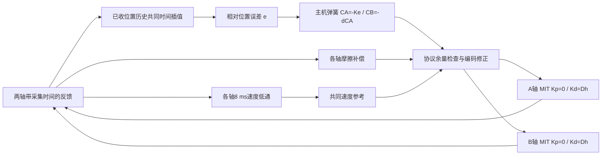
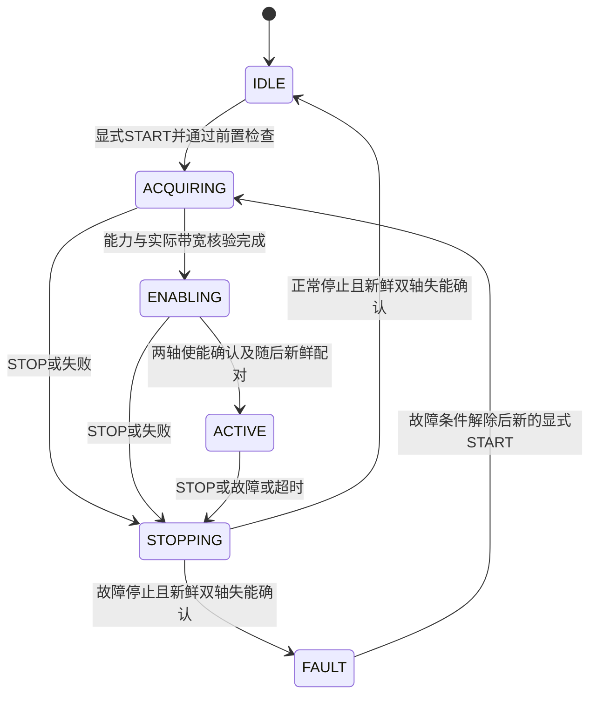

# 高刚度、低拖动阻力双边力控实现教程

本文说明当前差模力矩双边控制的算法、软件接口、跨机器部署及验收。全文使用SI单位：rad、rad/s、Nm、s。当前主路径为 `differential_torque`：主机计算反向弹簧力，电机保留本地速度阻尼；两轴共同运动时不施加世界坐标位置约束。实际运动仍有惯量、速度滤波与通信延迟带来的动态反力。

本机参考参数为K=50 Nm/rad、Dc=0.4975 Nm·s/rad、本地阻尼B=0.005 Nm·s/rad，对应原生MIT P0/D1。通用默认仍为 `shared_reference`；要使用本文方案，应显式选择[三轴物理配置](../config/bilateral_physical_rig.md)或为自己的拓扑建立完整配置。控制结构、模型参数、部署版本分别记录，不能把某次标定合格当作双边应用已经通过。

最新[独立A/C标定](2026-11-06-independent-ac-calibration.md)和[联轴减阻对照](2026-11-06-reconnected-friction-comparison.md)保留详细测量；重复阶段记录移入[历史索引](experiment-history.md)。源码精简后的新构建和硬件验收见[清理记录](cleanup-validation.md)。历史结果不替代新机器自身的试验。

目录：

- [1. 目标与适用范围](#scope)
- [2. 三种控制结构及演进原因](#architecture)
- [3. 当前控制律与坐标约定](#law)
- [4. 滤波、摩擦与协议编码](#signal)
- [5. 正常控制循环的伪代码](#loop)
- [6. 生命周期、反馈失鲜与停机](#lifecycle)
- [7. 软件组成与移植接口](#software)
- [8. 在另一台计算机上构建和仿真](#simulation)
- [9. 创建真机部署配置](#hardware-config)
- [10. 新机器上的调试顺序](#commissioning)
- [11. 自动和人工验收](#acceptance)
- [12. 数据记录与效果评价](#measurement)
- [13. 常见问题定位](#troubleshooting)
- [14. 已验证结果、边界及交付清单](#evidence)

相同硬件换计算机时，可先按第8、9节完成构建和配置，再按第10、11节调试验收，并用第12节保存记录。更换电机或在非ROS平台实现时，先阅读第3～7节，明确坐标、控制律、采样时间和停止接口，再开始移植。第2节解释从最初方案到当前方案的变化及其原因。

实施时可复制[迁移验收记录模板](bilateral-control-deployment-record.md)，逐项填写本机配置与每轮实验路径。模板中的结果默认“未执行”；本教程中的历史通过记录不作为新机器的验收结果。

<a id="scope"></a>
## 1. 目标与适用范围

双边力控需要同时处理两种运动：

| 运动 | 例子 | 期望行为 |
| --- | --- | --- |
| 相对运动，也称差模 | A 转动而 B 未跟上；两轴向相反方向运动 | 较大恢复力和阻尼，使两轴保持相对关系 |
| 共同运动，也称共模 | 两轴以相同的方向映射、相近速度一起转动 | 尽量少的阻力，不把两轴固定到世界坐标 |

本实现是基于位置、速度反馈的双向耦合，没有独立外力传感器闭环。电机报告力矩不等于操作者手力。它支持方向映射 d=+1 或 −1，未实现任意位置比例、力矩比例、多自由度雅可比映射或主动惯量抵消。

迁移分为两种情况：

1. **相同电机及适配器，换计算机**：重点检查软件版本、串口、ID、协议量程、坐标、标定文件、调度与通信时间。
2. **换电机、驱动器或机械传动**：还要适配实际力矩接口、本地速度反馈、输出轴单位、惯量、摩擦、负载和内部动态，重新选择增益并验收。不能只复制 K=50、Kd=1。

项目当前内置的电机 profile 为 `j4310_v11`、`j4310_v12`。其他型号需要先适配驱动和能力检查。纯力矩接口若没有等效的本地速度环，不能直接把这里的 D 项移到一个有较大延迟的主机循环，并继承本次验证结论。

<a id="architecture"></a>
## 2. 三种控制结构及演进原因

### 2.1 最初的对端跟随：native

扣除两轴启动原点并对齐方向后，记相对位置为 e=xA−xB。理想连续控制为：

```text
τA = −K e − Dc(vA − vB) − B vA
τB = +K e + Dc(vA − vB) − B vB
```

早期实现让每个电机直接跟随对端位置和速度，由原生位置环和速度环产生上述耦合。最初默认 K=16、Dc=0.35、B=0.35、控制频率 200 Hz，并使用 0.5 Nm 应用预算；后来提高到 K=50、减小本地阻尼后，暴露出轻推后持续振荡的问题。

实际反馈会经过采样、速度滤波、传输和执行。高刚度放大过时位置产生的误差；有迟滞的速度反馈也不能按理想耗散项理解。31 Hz 的周期约为 32 ms，4 ms 纯延迟就相当于约45°相位滞后。增大 D 可能同时放大这条存在相位误差的通道。

历史真机记录出现约28–31 Hz反相振动。握紧电机时增加的机械阻尼和约束可能压住振动，轻推后释放则可能显露自激。这是与记录相符的机制解释，不是对电机内部滤波节点的唯一辨识。

### 2.2 先稳定相对运动：shared_reference

共享参考取共同位置 c=(xA+xB)/2，两侧原生 Kp=2K，并使用共同速度目标。理想情况下，单轴位置恢复力仍是 ±Ke。

方向已对齐、两轴同时使用相同参考，并忽略量化、内部动态、摩擦补偿及其他独立前馈时，力矩差为：

```text
τA − τB = −2K e − (2Dc+B)(vA−vB)
```

共同参考从力矩差中抵消，使相对恢复更依赖本地反馈，减弱对端参考迟滞的影响。两轴惯量不同、命令到达错相及本地滤波仍限制这个结论。

历史真机对照显示：共享参考在 V_BW=40 Hz 下仍有持续过程纹波；共享参考结合实际读回的 V_BW=100 Hz 才通过正反30°完整流程。因此抑振依据是结构和实际速度反馈条件的共同改变，不能归因于单一摩擦参数。

### 2.3 再消除共同位置拖拽：differential_torque

共享位置参考会落后实际共同运动。若两轴一起以 v 转动，参考滞后 T，每轴的位置误差近似为 −Tv。由于原生 Kp=2K：

```text
每轴额外位置反力 ≈ −2K T v
两轴合计额外反力 ≈ −4K T v
```

K=50、T=0.004、v=1 时，两轴合计约 −0.8 Nm。即使 B=0.005，仍可能明显难推。历史实际 CAN 目标重建得到约3.9–4.3 ms的共同位置滞后，以及约−0.80～−0.86 Nm/(rad/s)的位置项合计斜率，支持这一解释。

当前模式将原生 Kp 设为0，直接发送主机计算的反向弹簧力，去掉滞后的共同位置环；原生 Kd=1及共同速度参考继续保留。**弹簧经过主机和通信后仍有延迟，P0本身不是无条件稳定保证。** 该结构的参数需要用相应电机模型、实际链路和真机流程共同验证。

11-04版本直接用两轴各自latest位置求弹簧。11-05高速台架暴露了另一条延迟路径：共同速度为v、两轴反馈错时Δt时，伪角差约为vΔt，伪弹簧约为KvΔt。当前实现仅将弹簧位置改为已收到历史中的共同时间插值，见[第6.2节](#common-time-spring)；它没有更改本地速度阻尼，也没有消除全部通信延迟。

| 模式 | 原生 Kp | 原生 Kd | 弹簧实现位置 |
| --- | ---: | ---: | --- |
| native | K | Dc+B | 电机追随对端位置 |
| shared_reference | 2K | 2Dc+B | 电机追随共同位置 |
| differential_torque | 0 | 2Dc+B | 主机计算反向前馈力矩 |

### 2.4 抑振与减阻分别改变了什么

从最初实现迁移时，应保留整个反馈和执行结构，不能只复制一组 K、D 数字：

| 改动 | 解决的具体问题 | 不能据此推断的结论 |
| --- | --- | --- |
| 相同的共同速度目标，保留电机本地原生D | 两轴目标一致且同时执行时，共同参考从差模力矩中抵消；相对速度由本地反馈阻尼抑制 | 异步执行、内部滤波和饱和也会影响闭环 |
| 实际V_BW从40改为100 Hz，并在每次START读回 | 改善本次电机的速度反馈动态；原40 Hz条件下的共享参考仍有纹波 | 寄存器数值100对所有型号都有效，或已经准确辨识内部环路 |
| 主机速度参考使用8 ms低通 | 限制通过通信返回的参考速度高频分量，本地D不串联这个主机滤波器 | 低通本身能消除任意延迟造成的不稳定 |
| 差模主机弹簧、原生P0 | 保留相对刚度，去掉滞后共同位置参考造成的拖拽 | 主机弹簧无延迟，或P0自动保证稳定 |
| 摩擦零速/换向状态机、幅值和变化率约束 | 降低运动阻力，同时避免直接使用速度符号切换大助力 | 摩擦补偿是最初28–31 Hz振荡的唯一原因或唯一解法 |

因此，“不抖”和“轻便”是分两步取得的：共享参考与实际速度反馈条件先改善了相对运动稳定性，差模力矩随后降低了共同运动阻力。去掉原生位置环时仍保留本地D；将P、D一起清零后只发送 `−K·e`，并不是本文方案。

本机历史记录支持上述设计方向，但没有给出任意电机、任意刚度下的稳定性保证。迁移的判据仍是目标参数下的静置、轻推释放、往返和角差全过程测试；第14.2节的新模型失败也说明，更小的标定残差不能替代闭环验证。

### 2.5 最初版本、当前默认和已验收方案对照

下表比较最初提交`5d796ba`的真机默认、当前[通用配置](../config/dm_motors.yaml)的真机默认，以及2026-11-04实际验收的差模方案。它们是三份不同的配置；历史仿真variant的力矩预算与当前通用仿真variant的补偿开关另有覆盖，不属于本表。

| 项目 | 最初真机默认 | 当前通用真机默认 | 本教程已验收差模方案 |
| --- | --- | --- | --- |
| 控制结构 | 对端跟随，等效`native` | `shared_reference` | `differential_torque` |
| 有效相对刚度K | 16 | 50 | 50 |
| 耦合阻尼Dc | 0.35 | 0.4975 | 0.4975 |
| 本地阻尼B | 0.35 | 0.005 | 0.005 |
| 正常未缩放原生Kp / Kd | 16 / 0.7 | 100 / 1 | 0 / 1 |
| 控制器频率 / bringup驱动频率 | 200 / 500 Hz | 500 / 500 Hz | 500 / 500 Hz |
| 应用力矩预算`max_torque` | 0.5 Nm | 0，无额外应用预算 | 0，无额外应用预算 |
| 摩擦补偿 | 未实现 | 比例0.6，每轴上限0.2 Nm | 比例0.6，每轴上限0.2 Nm |
| 速度带宽准备与核验 | 无本方案的启动核验 | 驱动准备RAM 100 Hz，START独立读回 | 同左，真机已读回100 Hz |
| 差模真机只读许可 | 无该选项 | 默认关闭 | 显式`allow_differential_hardware=true` |

最初的200 Hz指控制器循环，不能据此认定当时驱动也只运行200 Hz。当前默认与差模方案的K、Dc、B相同，但位置反馈进入控制的位置不同，所以只复制增益不会得到相同手感。将模式切换为差模时，需要同时检查原生P0、共同速度参考、本地D和第9节的启动配置。

<a id="law"></a>
## 3. 当前控制律与坐标约定

### 3.1 坐标与方向只能转换一次

驱动先把原生编码器坐标转换成关节坐标 q、v、τ，处理本轴 `direction` 和 `software_offset`。控制器再使用整数 `direction=d∈{−1,+1}` 表示两轴的相对转向。这两个方向配置不能互相代替。

每次显式 START 在新鲜失能反馈上记录 qA0、qB0：

```text
xA = qA − qA0
xB = d (qB − qB0)
e  = xA − xB + δ
```

正常拖动 δ=0。δ 是自动检测时的虚拟相对角差，不修改编码器零点或软件零偏。START 捕获原点也不是物理回零；自动测试中的回零是单独的真实运动。

若系统需要非1:1传动或位置缩放，必须同时推导位置、速度与力矩变换并保持功率一致；当前只支持正反方向映射。更换减速比时，要先确定协议位置、速度和力矩究竟对应电机轴还是输出轴。

### 3.2 弹簧、阻尼与前馈

主机弹簧：

```text
CA = −K e
CB = −d CA
```

令各轴按自身采集时间滤波后的速度为 vfA、vfB：

```text
vc = (vfA + d vfB) / 2
Dh = 2Dc + B
r  = 2Dc / Dh               # Dh=0时令r=0
vrefA = r vc
vrefB = d r vc
KpA = KpB = 0
KdA = KdB = Dh
```

正常未限幅时，记协议编码后电机实际收到的速度和阻尼为`vwire`、`Dwire`。忽略前馈力矩字段自身的量化时，电机侧力矩为：

```text
τA ≈ Dwire(vwireA − vlocalA) + CA + FA + QA
τB ≈ Dwire(vwireB − vlocalB) + CB + FB + QB
```

F 为模型摩擦补偿，Q 为已知速度目标编码误差修正。补偿完全抵消该误差、且Dh可精确编码时，上式化为`τA≈Dh(vrefA−vlocalA)+CA+FA`，B轴同理；这里不能再次加Q。`vlocal` 是电机本地速度反馈，不是主机又经通信送回的速度；其实际动态仍取决于固件及配置。普通运行没有独立测试扰动，测试接口的扰动力矩需另外计入前馈及限幅。

方向对齐后的连续弹簧满足 CA+d·CB=0，所以不主动固定共同位置。不同电机的实际执行延迟、力矩转换误差、量化和饱和可能使实际机械力矩不完全抵消。

### 3.3 为什么可以既硬又轻

本机 Dh=1、r=0.995。忽略延迟、在稳态下：

| 运动 | 速度参考 | 阻尼行为 |
| --- | --- | --- |
| 两轴同向同速1 rad/s | 各自方向上的0.995 rad/s | 每轴约0.005 Nm阻尼 |
| 方向对齐后A为+1、B为−1 rad/s | 共同速度为0 | 每轴约1 Nm阻尼，抵抗相对运动 |

K=50时，1°相对误差对应每侧约0.873 Nm弹簧力矩。刚度保留在相对坐标上；原生 Kp=0不等于两轴之间没有刚度。

8 ms参考滤波、通信、惯量及剩余摩擦仍会造成加速阻力和释放后的滑行。当前方案没有使用速度导数前馈、位置预测或主动惯量抵消。



### 3.4 用理想模型理解增益，再用实际链路验证

先把B轴转换到同一方向，令其速度为`vB=d·dqB/dt`。正常运行取δ=0，忽略采样、滤波、延迟、量化、摩擦补偿和饱和后，当前控制律回到第2.1节的连续形式。弹簧储能为`E=K·e²/2`，控制器对两轴做功满足：

```text
τA·vA + (d·τB)·vB + dE/dt
    = −Dc·(vA−vB)² − B·(vA²+vB²)
```

右边的第一项只耗散相对运动，第二项同时阻碍共同运动。这说明为什么需要较大的Dc和较小的B，而不是给每轴添加很大的对地阻尼。这个式子不包含主动摩擦补偿，也不包含实际采样链路；它是解释设计意图的理想模型，不是对离散系统的无条件无源性证明。

若两轴换算到同一输出轴单位后的惯量均为J，忽略物理摩擦和其他机械负载，则相对误差与共同速度分别近似满足：

```text
J·d²e/dt² + (2Dc+B)·de/dt + 2K·e = τexternal,A − d·τexternal,B
J·dvc/dt + B·vc = (τexternal,A + d·τexternal,B)/2
```

相对运动的无阻尼固有频率为`sqrt(2K/J)/(2π)`，阻尼比为`(2Dc+B)/(2·sqrt(2KJ))`。增大K会提高响应频率，也会让固定通信延迟占据更大的相位比例；减小电机惯量并不意味着可以无条件增大K。在相同理想阻尼比下，所需Dh随`sqrt(KJ)`变化，但驱动的D上限、实际反馈带宽和采样延迟往往先限制可用增益。

共同运动方程仍包含J，因此本方案降低拖动反力，并没有消除真实转动惯量。两轴惯量不同、有减速器弹性或附加负载时，上述简化方程不再充分，应使用双轴模型验证。J也必须有可信的动态辨识依据；仅凭低速摩擦拟合残差很小，不能认定同时拟合出的惯量准确。

### 3.5 移植时先用数值例子核对符号和力矩分工

以下是**不连接电机的控制公式检查**。取K=50、Dc=0.4975、B=0.005，因此Dh=1、r=0.995；关闭摩擦补偿，假设参考滤波已经达到稳态、本地速度等于给定速度，忽略量化、延迟和限幅。表中速度均为各轴自己的关节坐标，e已经按第3.1节完成方向映射；“总控制力矩”包含电机本地D产生的力矩。

| 输入状态 | d | e / rad | vA、vB / (rad/s) | vrefA、vrefB / (rad/s) | 弹簧CA、CB / Nm | 总控制力矩τA、τB / Nm |
| --- | ---: | ---: | --- | --- | --- | --- |
| 静止但A相对领先1° | +1 | +0.0174533 | 0、0 | 0、0 | −0.872665、+0.872665 | −0.872665、+0.872665 |
| 同向共同运动 | +1 | 0 | +1、+1 | +0.995、+0.995 | 0、0 | −0.005、−0.005 |
| 两轴反向运动 | +1 | 0 | +1、−1 | 0、0 | 0、0 | −1、+1 |
| 镜像映射下静止相差1° | −1 | +0.0174533 | 0、0 | 0、0 | −0.872665、−0.872665 | −0.872665、−0.872665 |
| 镜像映射下共同运动 | −1 | 0 | +1、−1 | +0.995、−0.995 | 0、0 | −0.005、+0.005 |

MIT的前馈字段在这组简化条件下只写CA或CB；表中速度案例的阻尼力矩由本地Kd产生，**不能再把总控制力矩写进前馈，否则会重复施加阻尼**。恢复摩擦补偿和编码修正后，才按第3.2节把F和Q加入前馈。

再做三个纯软件检查：两轴共同平移`qA+=a、qB+=d·a`时弹簧不变；改变δ时只有相对位置目标改变，编码器原点不变；增大相对误差到前馈编码余量不足时，两侧弹簧按同一比例缩小，在正常恢复且无应用预算的条件下仍保留原生D。生产代码的相应回归见[test_differential.cpp](../src/dm_motor_bilateral_control/test/test_differential.cpp)。这些例子用于排除符号、单位和重复阻尼错误，不是将所列状态或力矩直接施加到实物的操作指令。

<a id="signal"></a>
## 4. 滤波、摩擦与协议编码

### 4.1 根据采集时间更新速度参考滤波

8 ms速度参考滤波在每轴独立推进，使用反馈字段`receive_time`的时间差Δt。该字段是**主机单调采集/接收时间**，不是ROS墙钟，也不是电机内部采样时间；具体契约见[MotorFeedback.msg](../src/dm_motor_interfaces/msg/MotorFeedback.msg)。电机内部采样、报告滤波及帧到达主机之前的延迟，不会被这个时间戳自动扣除。

```text
α = 1 − exp(−Δt / 0.008)
vf = (1−α) vf_previous + α v_centered
```

首个样本建立时间基准，输出从0开始；相同采集时间不再次推进这个参考滤波；时间倒退或无效输入不能继续控制。不能把重复的状态消息当成新的物理样本，也不能按“本循环应该是2 ms”覆盖实际时间。

摩擦补偿内部的10 ms滤波使用另一时钟：控制循环的实际单调时间差`dt = time - last_tick`。在反馈仍满足质量门限时，即使本次循环沿用同一反馈值，摩擦滤波和力矩斜率限制仍按该dt推进；质量降级时清除其状态。移植时应保留这个区别，不能把两个滤波器都改成按消息次数或固定2 ms更新。

项目 compact 速度码按12 bit、范围±VMAX解码。对以码区间下沿表示的速度，控制计算采用区间中点估计：`v_centered=clamp(v + axis_direction×VMAX/4095, −VMAX, +VMAX)`；原始反馈和保护判断保持原值。这里的 `axis_direction` 是驱动本轴的方向，不是两轴映射的 `d`。其他协议若已经使用最近舍入或不同码定义，不应照搬这个修正。

### 4.2 摩擦补偿与适用域

当前使用各轴自身速度及独立标定模型，不根据对端速度猜摩擦，也不把惯量、重力、传感器偏置当成摩擦加入。

| 项目 | 本机配置或实现 |
| --- | --- |
| 补偿比例 | 0.6 |
| 每轴补偿合计上限 | 11-04历史配置0.2 Nm；11-05显式B100台架配置0.4 Nm，原模型与extra助力共用 |
| 摩擦速度滤波时间常数 | 10 ms，与参考速度8 ms滤波不同 |
| 零速门限 / 平滑尺度 | 0.02 / 0.03 rad/s |
| 正常助力跟随斜率上限 | 5 Nm/s |
| 零速、换向及失鲜 | 可立即清除旧助力，不受上述斜率限制；静止不主动起步 |
| 超出标定速度域 | 解析模型按相应边界计算，并标记域外限制；查表模型在最低已测滑动速度以下不助力 |

具体状态机以 `system_parameters.hpp` 中的 `FrictionCompensator` 为准，不能用一个裸 `sign(v)` 替代。实验性的细位置摩擦补偿不属于本教程基准方案，也不需要开启125 Hz寄存器位置观察。

当前两轴使用库仑＋黏性模型，模型滑动摩擦为`f(v)=Fc·sign(v)+b·v`。令传给补偿器的本轴控制速度为 `vin`，上一周期助力为 `Fprev`。关闭补偿、`abs(vin)≤0.02` 或 `Fprev·vin<0` 时先立即复位；其他情况下按下面的顺序计算：

```text
vf ← vf + (1−exp(−dt/0.01))·(vin−vf)
若 abs(vf)≤0.02：输出0，保留vf继续积累
v = clamp(vf, velocity_min, velocity_max)
w = tanh(max(0, abs(v)−0.02)/0.03)
cap = min(0.5, friction_torque_limit, resolved_driver_torque_limit)
若 max_torque > 0：cap = min(cap, 0.5·max_torque)
Frequest = clamp(fraction·w·f(v), −cap, +cap)
F = clamp(Fprev + clamp(Frequest−Fprev, −5dt, +5dt), −cap, +cap)
```

以上是原标定模型、附加速度助力为零时的补偿路径；查表模型还在输入低于该方向最低已测滑动速度时复位。`resolved_driver_torque_limit`是驱动坐标映射与命令限制共同给出的前馈力矩限值，不是本周期的实测力矩。生产节点先合并驱动、用户补偿上限及正应用预算的一半，补偿器再施加0.5 Nm硬上限；上式合并展示这一顺序的限幅结果。它限制的是补偿分量，后续仍需检查完整MIT目标。11-04历史减阻验收无额外应用预算，`fraction=0.6`、`cap=0.2 Nm`；11-05显式B100台架配置将共享补偿cap设为0.4 Nm。两者沿用的原模型系数来自2026-10-30的40秒快速辨识：

| 轴 | 库仑摩擦Fc / Nm | 黏性系数b / (Nm·s/rad) | 实测速度域 / (rad/s) |
| --- | ---: | ---: | --- |
| A | 0.14169 | 拟合接近0 | −0.4108～+0.3915 |
| B | 0.10165 | 拟合接近0 | −0.3272～+0.3228 |

这些模型通过的是该次快速辨识的0.02 Nm残差门限，不是精密流程的0.003 Nm标准，也不是外部力矩传感器认证。黏性项拟合接近0不能证明全速黏性为0。域外钳制防止无约束外推，不能证明域外精度；后续较快拖动的系统表现与模型辨识覆盖是两种不同证据。

11-05源码增加默认0的`extra_viscous_a/b`及独立`extra_viscous_velocity_limit`。它是显式控制器助力增益，不写回registry，也不扩张上表的标定速度域。启用该增益时，在上述共享限幅与斜率限制之前改为：

```text
ve = clamp(vf, −extra_viscous_velocity_limit, +extra_viscous_velocity_limit)
we = tanh(max(0, abs(ve)−0.02)/0.03)
Frequest = clamp(fraction·w·f(v) + extra_viscous_axis·ve·we, −cap, +cap)
```

附加项不再乘`fraction`，但仍由整个摩擦补偿开关控制；`fraction=0`、零速、换向及失鲜会清除整个助力状态。两项使用同一个10 ms速度滤波、合计力矩上限和5 Nm/s斜率限制。默认extra为0时保持原算法；不能通过扩大原registry的速度域来模仿这一项。

本机B100显式配置为A系数0、B系数0.02584737521699079 Nm·s/rad、独立速度上界13.2 rad/s、共享cap 0.4 Nm，原模型比例仍为0.6。B100表示使用本次独立辨识B黏性估计值的100%，不是总摩擦完全抵消。A/C同轴记录不能唯一分配A和C的个体黏性，故没有据此给A增加速度助力；这些数值不能直接移植到另一台电机。选择依据、释放结果和仿真余量见[第14.3节](#synchronization-evidence)，完整接口见[包说明](../src/dm_motor_bilateral_control/README.md#从共享标定启用摩擦补偿)。本教程的11-04历史减阻验收及第5节简化算法均按extra为0理解。

`velocity_min/max`只是注册表保存的外边界，不代表边界之间的每一段速度都有独立验证数据。当前解析补偿器不会自动识别这个范围内未采到的低速区间；应另外检查正、反方向的训练与验证覆盖，尤其是零速附近。查表模型的最低滑动速度门禁也不能推广为所有模型共有的行为。迁移时将这项检查和轻推、换向验收一起保留，不能只比较两个端点。

新机器先关闭补偿完成基础耦合检查，再用本机实际保存的模型启用。标定文件按完整 namespace 和 hardware/simulation 分类；当前加载器还核对 motor ID、模式、方向、偏置及协议量程。这个核对不包含电机物理序列号，不能代替现场确认“文件确实属于这台电机”。

过补会供能。摩擦随温度、姿态或负载降低时，即使补偿比例小于1，也可能改变释放后的滑行和稳定性。较低的平均拖动力不能代替轻推释放、反转及静止漂移检查。

### 4.3 原生 MIT、力矩单位与协议边界

MIT形式为：

```text
Tref = Kp(pdes−p) + Kd(vdes−v) + tff
```

移植前必须核对本机协议量程、位宽、正负号和力矩单位。若命令是电流，需使用正确的力矩常数及传动映射；如果固件已有转换，不要重复乘减速比。不能只因为帧长度相同就假设为相同电机协议。

本项目请求策略限制 Kd≤1，当前协议编码器的 Kd字段范围为0～5。不同电机的策略限制和编码量程不是同一个概念。K/D必须通过双方能力检查；不能只改控制器常量而不改驱动、面板和测试。

Kp=0时位置字段仍必须合法。本实现选择协议和关节边界交集内的中性位置，而不把很大的相对参考角写入一个已经不参与控制的位置字段。

无额外应用预算时，速度目标编码会产生已知误差，使用：

```text
Dwire = decode(encode(Kd))
Q = Dwire × (vref − decode(encode(vref)))
```

修正按各轴坐标变换后计算，并纳入力矩字段余量。MIT力矩码本身不一定有精确零点；不能伪造一个“零码完全无力矩”的假设。

### 4.4 三种限制必须分清

| 限制 | 行为 | 对阻尼的影响 |
| --- | --- | --- |
| 协议前馈余量不足 | 两轴用同一比例缩小弹簧，保留反向关系 | 正常恢复比例、`max_torque=0`时保留原生D |
| 正的应用预算 `max_torque` | 按预算共同缩小弹簧与原生增益 | D也会减小，需单独验证 |
| 反馈降级或STOP | 撤销助力/控制，必要时双轴失能 | 不能依赖这时仍保留D或机械抱闸 |

前馈余量还要扣除摩擦、量化修正、独立测试扰动和编码余量。`max_torque=0`仅表示不启用额外应用预算，设备物理极限、协议范围和驱动保护仍有效。限制前馈字段不能证明原生D与前馈叠加后的实际电机力矩具有同样的硬上限。

<a id="loop"></a>
## 5. 正常控制循环的伪代码

以下只展示 **ACTIVE、质量正常、恢复比例为1、无独立扰动、`max_torque=0`** 的算法骨架。真实实现还需要下一节的生命周期、降级、超时和STOP路径。不能把这段循环单独用于实物。

```python
# q、v已处于各轴关节坐标；d为两轴方向关系。
# 8 ms参考滤波只随本轴新的主机采集时间推进。
# 摩擦补偿使用控制循环的实际dt；两个时间差不混用。
validate_samples_and_active_contract()
control_dt = monotonic_now - previous_control_tick
vf_a = update_filter(center_velocity(sample_a), sample_a.receive_time)
vf_b = update_filter(center_velocity(sample_b), sample_b.receive_time)

spring = common_time_positions(history_a, history_b, monotonic_now,
                               max_age=feedback_age,
                               max_bracket_gap=min(feedback_age, 4 / rate))
require_or_stop_both(spring is not None)  # 无有效历史时不回退latest
q_a, q_b = spring.position  # 仅位置对齐，不替换上面的速度输入
e = (q_a - origin_a) - d * (q_b - origin_b) + angle_offset
c_a = -K * e
c_b = -d * c_a

dh = 2 * Dc + B
ratio = 0 if dh == 0 else 2 * Dc / dh
vc = (vf_a + d * vf_b) / 2
vref = [ratio * vc, d * ratio * vc]

for i in [A, B]:
    friction[i] = friction_state_machine(model[i], center_velocity(sample[i]), control_dt)
    target[i] = MIT(p=encodable_neutral_position(i), v=vref[i],
                    kp=0, kd=dh, ff=friction[i])
    decoded_v = encode_decode_velocity_in_joint_coordinates(target[i], i)
    decoded_kd = encode_decode_damping(target[i].kd, i)
    correction[i] = decoded_kd * (vref[i] - decoded_v)
    base_ff[i] = friction[i] + correction[i]
    headroom[i] = allowed_ff[i] - abs(base_ff[i]) - torque_code_reserve[i]
    require(headroom[i] >= 0)

scale = min(1, ratio_or_one(headroom[A], abs(c_a)),
               ratio_or_one(headroom[B], abs(c_b)))
target[A].ff = base_ff[A] + scale * c_a
target[B].ff = base_ff[B] + scale * c_b

for i in [A, B]:
    validate_encode_decode(target[i], capabilities[i])
    send_with_source_sequence_and_expiry(target[i])
record_feedback_targets_scaling_and_quality()
```

`ratio_or_one(h, 0)`返回1。恢复和正应用预算不要自行拼接到该简化代码，应对照生产核心 `differential_output()`：补偿、扰动、原生增益、量化修正和弹簧缩放有明确的计算次序。

<a id="lifecycle"></a>
## 6. 生命周期、反馈失鲜与停机

启动网页、加载配置、重连和收到新反馈均不能自动使能。标准生命周期为：



新的START不自动清除驱动故障、修改零点或恢复旧扰动。设备没有重新就绪时，即使收到START也应拒绝。

### 6.1 开始前检查

- 两轴真实/模拟身份一致；差模真机需要只读启动参数 `allow_differential_hardware=true`。
- 两轴处于MIT模式，失能、静止、反馈新鲜、绝对位置连续性有效，无设备或主机故障。
- 方向、偏置、量程及能力已读取；控制器频率不超过驱动能力；当前只运行一个运动应用。
- 驱动初始化时准备实际速度带宽；每次START再次独立读回两轴V_BW，并取得读回后的新鲜失能反馈。
- 补偿开启时，两轴模型均已加载并匹配；没有未结束的维护操作。
- 建立新的操作会话、原点和滤波状态，不复用上次的偏置、脉冲或补偿记忆。

Dashboard会话不是排他的运动锁。其他程序向同一驱动发目标可能覆盖本控制器；来源检测也无法保证发现短于状态发布间隔的瞬时覆盖。

### 6.2 当前配置的时间边界

| 参数 | 本机参考值 | 含义 |
| --- | ---: | --- |
| controller / driver control rate | 500 Hz / 500 Hz | 名义控制周期2 ms |
| `feedback_age` | 0.020 s | 配对超过此年龄进入降级 |
| `pair_skew` | 0.005 s | 合格配对的最大主机采集/接收时差 |
| `feedback_stop` | 0.080 s | 持续失鲜触发双停 |
| `recovery_time` | 0.100 s | 三组新鲜配对后渐进恢复 |
| `target_validity` | 0.050 s | 控制目标有效期 |
| 控制回调停顿门限 | 0.050 s | `min(target_validity, feedback_stop)`，实际回调间隔超过此值后进入STOP |
| `operator_timeout` | 1.0 s | 操作会话心跳时限 |
| driver watchdog / feedback timeout | 0.2 / 0.1 s | 驱动层时限，另有0.25 s命令超时 |

500 Hz是名义控制调度频率，不是电机内部MIT环频率，也不是已证明的硬实时期限。`BilateralState`当前每20 ms发布一次，即50 Hz；不能用它替代逐帧`MotorFeedback`重建500 Hz控制输入。移植时分别统计采集间隔、控制周期、发送间隔和两轴错相，保留极值与失鲜事件，不能仅凭平均频率达到500 Hz认定时序等价。

控制回调停顿检查与反馈失鲜检查独立：在启动或持续控制阶段，若本次与上次控制回调相隔超过50 ms，节点在这次回调中报告`Bilateral control timer stalled`并进入双轴STOP，即使收到的反馈仍新鲜。这个检查依赖控制回调恢复执行，不能保证主机完全卡住时也在50 ms内发出STOP；目标过期、驱动看门狗和独立监督仍承担各自的停止责任。

<a id="common-time-spring"></a>
反馈配对使用主机单调采集时间`receive_time`和序号。上述20/80 ms门限据此判断主机可见反馈的新鲜度，不是设备内部采样到执行的总延迟上界。11-04差模版本直接使用两轴latest位置；11-05节点通过`FeedbackPairs::common_time_positions()`另取弹簧位置：优先以两轴最新时间戳的较小值为共同时间，已有精确样本就使用该样本，否则只在已收到的前后两个连续关节位置间线性插值。若此处没有合法插值区间，则按时间倒序搜索两轴已经收到的样本端点，选择最近的共同合法时间；全部候选都失败才返回无效。

共同时间及所有插值端点必须在`feedback_age`内；当前源码还要求每轴插值跨度不大于`min(feedback_age, 4/rate)`，本机500 Hz对应8 ms。某个较新的跨度超界时也不能跨越它插值；较早的共同时间只有在同样的跨度、端点年龄限制内才可使用。没有合法交集时拒绝启动；活动耦合中同步结果无效则请求双停，不以latest代替。该路径不外推、不消费健康配对，也不使用仿真真值或将原始native位置跨±12.5折返直接插值；输入是驱动已解绕并完成方向/零偏转换的关节位置。核心中可选同步输入省略后的旧分支用于离线对照和中性验证，不是实际节点的降级策略。

初版同步实现使用5 ms边界，真机9 rad/s轮在约5.01177 ms插值跨度处STOP。历史批次最大约6.652 ms，推动了8 ms版本的调整；20 ms端点年龄与epoch/时间无效停机仍保留。其后V13高速释放又因8.121353 ms接收跨度停止，推动了上述较早共同时间搜索修复；并未继续放宽8/20 ms边界。修复后的V14 B80通过0.6、3、13.2 rad/s双向短轮及13.2 rad/s释放，V15 B100通过13.2 rad/s短轮及释放重试。随后V16完成301.24 s连续变速真机验收；失败、重试及各版本作用域见[第14.3节](#synchronization-evidence)。

**只对齐弹簧的位置输入。** 各轴最新速度、按自身采集时间推进的8 ms速度参考滤波、电机本地D、摩擦与编码修正保持原路径。主机接收时间也不等于电机内部采样时间，因此这不是硬件同步采样或同步执行保证。Dashboard的`position_error`与`virtual_position_error`仍来自健康历史pair；它们不一定等于本周期共同时间弹簧误差，不能直接乘K推断实际力矩。应同时保存实际目标、CAN与逐帧反馈。

普通持续耦合中，超过20 ms配对年龄时，当前生产路径将恢复比例置0、撤销控制前馈及原生增益并清除滤波/补偿状态；超过80 ms或出现硬故障则STOP。不能把它描述成“20 ms立即失能且始终保留D”。自动角差活动期间采用更严格的路径：质量或会话降级立即STOP，不保留旧角差等待恢复。独立扰动脉冲遇降级会取消，恢复后不会自动重发。在其他平台上修改任何时限都要重新核对完整停止链。

采集节点与控制器当前依赖同一主机单调时钟。跨计算机部署不能直接比较两台机器各自的monotonic时间；需要另外设计时钟对应、误差界和网络延迟验证。

### 6.3 停止完成的判定

STOP服务返回接受请求，不等于电机已经失能。应同时确认：

1. 两轴都有采集时间严格晚于本轮STOP开始的新鲜状态，报告失能，控制会话及待处理请求已释放。生产停止判据见[stop_confirmation.hpp](../src/dm_motor_bilateral_control/include/dm_motor_bilateral_control/stop_confirmation.hpp)。独立记录还要核验驱动活动目标已撤销；该helper本身不检查`target_active`。
2. 控制器发布新的停止确认，旧会话不能通过迟到回包重新激活。
3. 不再继续发送普通运动目标；停止未确认时明确报告，不用旧缓存冒充成功。

`BilateralState.stop_confirmed`是状态布尔值，不携带本轮STOP的唯一标识。读取到一次`true`不能单独证明刚发出的停止请求已经完成；记录器必须保留本轮停止时刻及之后的状态、反馈和目标变化，再与控制器确认一起判断。

当前节点进入STOPPING时立即向两轴发送STOP，随后每200 ms重发并释放控制会话。只有双轴确认成立、且距本轮停止开始超过600 ms，才转入IDLE或FAULT；超过3秒仍未确认则显示`STOP UNCONFIRMED`并继续重试。3秒是报告异常的时间，不是停止重试或判定成功的期限。相关实现见`bilateral_control_node.cpp`中的`begin_stop()`和`stop_tick()`；迁移时保留“请求、重试、新鲜确认”三步，具体时限再按目标驱动验证。

反馈计数用于检查本进程内的连续性；驱动重启后计数可以归零，不能要求新进程的计数大于旧进程STOP前的值。需要同时记录发布者/进程代际和主机采集时间，不能用计数归零否定新的有效失能反馈。

失能反馈不是轴已机械静止的证明；低阻力下仍可能滑行。当前方案也不提供机械抱闸。

<a id="software"></a>
## 7. 软件组成与移植接口

| 层 | 当前源文件 | 移植责任 |
| --- | --- | --- |
| 控制核心 | [bilateral.cpp](../src/dm_motor_bilateral_control/src/bilateral.cpp)、[bilateral.hpp](../src/dm_motor_bilateral_control/include/dm_motor_bilateral_control/bilateral.hpp) | 模式映射、共同速度、差模弹簧、编码与预算 |
| 控制生命周期 | [bilateral_control_node.cpp](../src/dm_motor_bilateral_control/src/bilateral_control_node.cpp) | START/STOP、身份、反馈质量、模型及实际带宽核验 |
| 摩擦模型 | [system_parameters.hpp](../src/dm_motor_control/include/dm_motor_control/system_parameters.hpp) | 读取匹配模型、补偿状态机、速度域 |
| 电机驱动 | [motor_node.cpp](../src/dm_motor_control/src/motor_node.cpp)、[runtime.cpp](../src/dm_motor_control/src/runtime.cpp) | 坐标、模式、看门狗、目标时效和失能 |
| 编解码 | [core.hpp](../src/dm_motor_control/include/dm_motor_control/core.hpp)、[protocol.cpp](../src/dm_motor_control/src/protocol.cpp) | 电机协议量程、量化、能力限制 |
| CAN服务 | [can_bus](../src/can_bus/README.md) | 唯一适配器所有者、实际收发、状态和观察记录 |
| 仿真 | [VirtualMotor / JointPhysics](../src/dm_motor_control/src/simulation/README.md) | 机械积分、执行动态、报告滤波、外部手柄输入 |
| 操作及测试 | [dashboard.py](../src/dm_motor_bilateral_control/dm_motor_bilateral_control/dashboard.py)、[auto_test.py](../src/dm_motor_bilateral_control/dm_motor_bilateral_control/auto_test.py) | 显式会话、报告、独立观察及STOP确认 |

不使用ROS时，至少需要等价的五类接口：带原始时间和序号的反馈、明确的电机能力/坐标描述、有有效期的目标发送、可独立执行的双轴停止、设备状态与故障读取。把通信适配与控制公式分开，控制核心不应读取仿真真值或网页状态。

当前ROS接口包括 `/motor_1/feedback`、`/motor_2/feedback`、各轴`state`和目标/请求接口，以及 `/bilateral_control/state`。具体字段以[消息定义](../src/dm_motor_interfaces/msg)为准。程序操作使用带会话与时间戳的[operator_control](../src/dm_motor_interfaces/srv/BilateralControl.srv)；一次裸`start`服务调用不包含完整的操作者心跳和独立监督逻辑。

目标、反馈和状态的源码/接口版本需要一起部署。只替换控制器可执行文件、继续运行旧Dashboard或旧消息库，可能造成参数查询失效或消息不兼容。

<a id="simulation"></a>
## 8. 在另一台计算机上构建和仿真

### 8.1 构建完整工作区

先把与本文对应的完整源码、配置及新增文件带到目标机器。本文核对时，当前实现包含尚未提交的修改和未跟踪文件，最新提交本身不包含全部方案；只克隆该提交，或只复制`git diff`，都会遗漏实现。交付时应形成包含新增文件的明确版本或源码归档，并保留文件清单；不要把本机`build/`、`install/`直接当作另一台机器的构建结果。

参考环境为Ubuntu 22.04、ROS 2 Humble。先安装对应ROS开发环境、colcon和rosdep；新机器若尚未初始化rosdep，先执行一次`sudo rosdep init`。使用未加载旧工作区overlay的新终端，在仓库根目录执行以下命令；只重新source一次ROS环境不会清除终端中继承的旧overlay。构建前应退出该工作区的旧控制进程：

```bash
source /opt/ros/humble/setup.bash
rosdep update
rosdep install --from-paths src --ignore-src -r -y
dm_build_base="$PWD/build"
dm_install_prefix="$PWD/install"
colcon build --build-base "$dm_build_base" --install-base "$dm_install_prefix" \
  --symlink-install --cmake-args -DCMAKE_BUILD_TYPE=RelWithDebInfo -DBUILD_TESTING=ON
source "$dm_install_prefix/setup.bash"
```

上面的两个目录是本次从当前源码构建时明确选择的输出位置；也可以改为独立的build/install目录，后续构建、测试与启动沿用同一组路径。目录中原来已有文件不代表它们属于当前源码。新终端须恢复本次构建的实际`dm_install_prefix`，不能不经核对便加载另一套旧overlay。

`--symlink-install`不会自动重编C++。核心依赖包括common、can_bus、dm_motor_interfaces、dm_motor_control、dm_motor_bilateral_control、dm_motor_bringup；标定另需dm_motor_calibration。移植时建议整体构建，避免使用另一工作区残留的消息或Python模块。

构建结束后，先确认当前终端找到的是这份工作区中的程序。下面只查看安装前缀、实际文件路径和文件哈希，不启动电机：

```bash
bilateral_install_prefix=$(ros2 pkg prefix dm_motor_bilateral_control)
printf '%s\n' "$bilateral_install_prefix"
readlink -f "$bilateral_install_prefix/lib/dm_motor_bilateral_control/bilateral_control_node"
sha256sum "$bilateral_install_prefix/lib/dm_motor_bilateral_control/bilateral_control_node"
```

对驱动及仿真器也保留对应的实际程序路径。路径和哈希说明所选文件的身份，不能单独证明已启动的进程使用了它；启动后还要核对进程、模式和参数读回。批量读取ROS参数时，逐项检查返回数量、类型和值；缺项或空列表应视为核验失败，不能将请求名称与空结果直接配对后当成通过。仅看到源文件已修改、构建命令退出成功或网页标题正确，都不足以确认运行版本。

### 8.2 不连接硬件的离线检查

先运行控制核心、差模、带宽核验和停止确认的纯软件回归，检查新机器上构建出的实现：

```bash
colcon test --packages-select dm_motor_bilateral_control \
  --ctest-args -R '^(test_bilateral|test_differential|test_velocity_bandwidth|test_stop_confirmation)$' \
  --output-on-failure
colcon test-result --verbose
```

这四项不启动真实总线或使能电机。确认测试数量非零，并检查每一项结果；`colcon test`命令本身结束不等于全部断言通过。它们覆盖公式、方向、限幅及状态判据，下面的物理基准再检查闭环运动。

项目内基准直接调用生产控制核心、物理模型、摩擦补偿和编解码器，不启动ROS或打开硬件传输：

```bash
python3 src/dm_motor_bilateral_control/test/offline_benchmark/run_benchmark.py \
  --binary build/dm_motor_bilateral_control/offline_bilateral_benchmark \
  --output "$(mktemp -d /tmp/bilateral-porting-short.XXXXXX)"
```

默认10场短回归；加`--full`执行固定88场矩阵。每次使用新的输出目录。矩阵覆盖正反拖动、轻推释放、方向、通信延迟、发送错相、K50/80/100及惯量/摩擦变化，但不是所有参数组合。详见[离线基准说明](../src/dm_motor_bilateral_control/test/offline_benchmark/README.md)。

另有独立的 `angle` 场景，复用生产 `AngleOffset` 五次曲线及同一控制路径，无外部手柄力矩。默认流程为5秒静置、2秒角差过渡、5秒保持，再经过模拟驱动和传输队列执行双轴STOP，随后观察1秒失能状态；默认总时长约13.002秒。它不在上述固定10/88场列表中，创建输入与直接执行的命令见[离线基准的角差示例](../src/dm_motor_bilateral_control/test/offline_benchmark/README.md)。新机器可用该场景先检查±5°，再按预先确定的门限扩展到±30°。

角差轨迹中的 `virtual_error` 是观测相对位置加已施加角差，不要求两轴各移动一半。评分时用 `simulated_stop_requested` 划分控制与停止阶段；STOP后的观测列保留最后普通反馈，不能当作新鲜采样。`.stop.json` 记录模拟FD的发送、设备接收及失能结果，仅证明这次离线模拟的停止过程。

上述CLI退出0仅表示各场程序成功且轨迹有效。要执行仓库定义的拖动力、释放停稳、饱和、半步长一致性及新增±5°角差断言，再运行以下离线测试；它通过CMake提供正确的基准二进制路径：

```bash
colcon test --packages-select dm_motor_bilateral_control \
  --ctest-args -R '^test_offline_benchmark$' --output-on-failure
colcon test-result --verbose
```

确认该测试确实执行并通过，而非因找不到 `DM_OFFLINE_BENCHMARK` 被跳过。断言针对仓库参考模型；更换模型时，需要为新模型预先定义自己的验收值，不能直接把参考模型数值当成新电机的实测值。

新机器的模型参数应单独保存，再通过`--profile`选择。物理积分需要对步长减半检查；不能通过增大模型摩擦来压住振动，再宣称控制器稳定。

### 8.3 运行完整ROS物理仿真

仓库的优化仿真配置已经显式选择差模模式，使用虚拟总线、空硬件端口和`require_virtual_bus=true`。示例使用隔离ROS域和独立HTTP端口；端口与域需与本机已有实例区分：

```bash
ROS_DOMAIN_ID=143 ROS_LOCALHOST_ONLY=1 \
ros2 launch dm_motor_bringup bilateral_control.launch.py \
  simulation:=true \
  config_file:="$PWD/config/bilateral_optimized_simulation_20261104.yaml" \
  can_dashboard_ports:='{main: 8180}' \
  motor_dashboard_ports:='{motor_1: 8181, motor_2: 8182}' \
  dashboard_port:=8184
```

双边页面为`http://127.0.0.1:8184/`。仿真命名空间是`/bilateral_optimized_simulation`，操作该实例的其他终端必须使用相同ROS域及发现设置。ROS域隔离不隔离HTTP端口。

开始前检查页面的模式为“差模力矩”（`differential_torque`）；进入ACTIVE后原生增益为P0/D1，补偿模型来自simulation树。分别对A/B施加短时外力、往返拖动，撤去外力后保持观察，再显式停止。仿真真值只用于环境施力和评分，不能进入生产控制器。

同域中的自动角差例子：

```bash
ROS_DOMAIN_ID=143 ROS_LOCALHOST_ONLY=1 \
ros2 run dm_motor_bilateral_control auto_test --simulation \
  --controller /bilateral_optimized_simulation/bilateral_control \
  --motor-a /bilateral_optimized_simulation/motor_1 \
  --motor-b /bilateral_optimized_simulation/motor_2 \
  --angle-offset-deg 5 --transition-time 2 --observe-seconds 5
```

该工具也会实际移动模拟关节回零。上述优化配置是本机辨识得到的候选模型，不是所有电机的出厂模型。完整bringup默认真机，遗漏`simulation:=true`不会自动进入仿真。

### 8.4 为其他电机建立模型时，分开三条动态通道

高刚度控制对反馈时序敏感。仿真至少应区分：驱动命令到实际力矩的执行通道、电机原生D使用的本地速度通道，以及通过CAN返回主机的报告通道。不能把Dashboard上速度曲线的滞后全部串入本地D；也不能拿已经滤波的报告力矩直接代替实际电磁力矩驱动物理模型。

当前候选配置明确使用以下参数，两轴相同；它们是本次记录支持的模型选择，不是设备固件的唯一辨识：

| 通道 | 配置字段 | 当前候选值 | 在模型中的用途 |
| --- | --- | ---: | --- |
| 力矩执行 | `torque_time_constant` | 0.002 s | 从需求到实际电磁力矩的响应 |
| 本地速度 | `velocity_time_constant` | 0 s | 原生D使用的内部速度估计附加滤波 |
| 报告速度来源 | `feedback_velocity_source` | `physical` | 选择物理速度作为报告滤波输入 |
| 报告速度滤波 / 延迟 | `feedback_velocity_time_constant` / `feedback_velocity_delay` | 0.0045 / 0.0015 s | 主机收到的速度通道动态 |
| 报告力矩滤波 / 延迟 | `feedback_torque_time_constant` / `feedback_torque_delay` | 0.012 / 0.002 s | 主机收到的力矩通道动态 |

本地附加滤波取0不证明真实固件无延迟；真实系统仍有执行、采样及通信动态。主机控制器的8 ms参考低通是另外一层，应继续保留。通信队列和发送错相也要单独建模，不能把这些时间常数相加成一个“总延迟”后就认为闭环等价。

生产[反馈模型](../src/dm_motor_control/include/dm_motor_control/simulation/feedback.hpp)在每个物理子步之后更新一次滤波器；读取反馈不会再次推进滤波。纯延迟通过带时间戳的历史样本插值，支持非整数步长的延迟；这是查询过去状态，不是控制器预测未来状态。反馈采集时间也不会被回写为滤波前的时间。迁移积分器时，应保留这个更新顺序，并用相同事件时间表做减半步长复核。

本机模型的J、库仑摩擦和静摩擦先验、饱和平台及独立验证误差见[模型校核记录](../src/dm_motor_bilateral_control/docs/2026-11-04-manual-identification.md)。换电机后应重新记录单轴与跟随轴数据，用实际发送目标及其时间回放，在独立动作上同时检查位置、报告速度和报告力矩。双手同时拖动时外力未知，不能按零外力拟合；只靠增大摩擦压住仿真振动，也不能说明模型正确。当前模型尚未复现的低速纹波见第14.2节，移植后的仿真通过仍需真机闭环验收。

<a id="hardware-config"></a>
## 9. 创建真机部署配置

### 9.1 运行配置与标定文件分开

运行配置是本项目的`version: 2`结构，通过`config_file`选择；不是ROS原生`--params-file`，也不是launch中的旧`config`拓扑覆盖参数。

先复制完整文件再编辑，不能拿下面的局部片段替换整个文件：

```bash
mkdir -p deployment/my_bilateral
cp -n config/dm_motors.yaml deployment/my_bilateral/runtime.yaml
```

`cp -n`保留已有部署文件。顶层标定路径改为同目录文件：

```yaml
version: 2
system_parameters_file: system_parameters.yaml
```

若已有这对电机的匹配标定，把其共享文件部署到`deployment/my_bilateral/system_parameters.yaml`。正式部署优先使用自动合格的模型；加载器也支持有显式人工拖动接受记录的候选，但保留其`qualified:false`，不能据此宣称精度合格。没有标定时，创建下面的空注册表，并在调试阶段显式关闭补偿：

```yaml
version: 1
motors:
  /motor_1:
    description: 本机A轴
    hardware:
      calibrations: {}
  /motor_2:
    description: 本机B轴
    hardware:
      calibrations: {}
```

标定文件的schema版本与运行配置不同。不要复制仓库中旧电机的数值后只改身份字段。如果添加namespace，例如`/robot1`，注册表键应对应`/robot1/motor_1`和`/robot1/motor_2`。

完整运行配置还包含`packages.dm_motor_calibration.quick_profiles`。它是**本机标定实验的激励方案引用**，含原报告绝对路径、文件哈希和机器身份；不是双边控制器消费的摩擦模型。换计算机时，应从部署副本中删除该块，或设为`quick_profiles: {}`，待本机完成合格实验后再登记本机引用。不要把旧报告路径或机器哈希改写成新机器的值来绕过检查。缺失或不匹配的引用会回退为未验证的标定候选，不会阻止已配置好的双边模型加载。

这三个位置的职责如下：

| 配置位置 | 内容 | 迁移方式 |
| --- | --- | --- |
| `runtime.yaml`的控制器/驱动/profile | 控制律、增益、拓扑、启动与保护参数 | 结合本机能力编辑并核对最终展开值 |
| `system_parameters_file`指向的注册表 | 按电机身份保存的实际摩擦模型 | 同一实物换计算机可携带匹配模型；换实物须重新标定 |
| `quick_profiles` | 本机合格实验的激励配方及来源凭据 | 新机器重新建立，不是通用电机参数 |

### 9.2 显式选择当前控制方式

在完整runtime.yaml的以下位置修改。此片段展示本机已经验证的目标参数；新型号应先完成低增益调试，再逐步达到目标值：

```yaml
packages:
  dm_motor_bilateral_control:
    nodes:
      bilateral_control_node:
        motor_a: motor_1
        motor_b: motor_2
        control_mode: differential_torque
        allow_differential_hardware: true
        required_velocity_bandwidth: 100.0
        rate: 500.0
        direction: 1
        stiffness: 50.0
        coupling_damping: 0.4975
        local_damping: 0.005
        max_torque: 0.0
        friction_compensation_enabled: false
        friction_compensation_fraction: 0.6
        friction_torque_limit: 0.2
        extra_viscous_a: 0.0
        extra_viscous_b: 0.0
        extra_viscous_velocity_limit: 0.0
```

这里刻意将补偿设为false，以便空注册表下完成基础调试。完成本机标定和模型核验后，将其改为true，并在确认双轴失能后重启控制器及配套面板，使修改后的YAML生效。也可在停止状态通过面板或ROS参数接口修改该开关，回读确认后再START；这种运行时修改仍需同步保存到部署配置，才能在下次启动时保留。关闭补偿时的手感不等同于已记录的60%原模型补偿结果。

本机另有[显式三电机物理台架配置](../config/bilateral_physical_rig.yaml)，在同一控制器位置保存B100的`extra_viscous_a: 0.0`、`extra_viscous_b: 0.02584737521699079`、`extra_viscous_velocity_limit: 13.2`和`friction_torque_limit: 0.4`，且补偿开启。普通默认配置未改变。它已经完成本机V14/V15短时对照、释放、整套冷启动及V16的301.24 s真机连续变速；这些证据不自动适用于新机器，应从上面的extra为0配置开始建立自己的记录。

**START会重新读取摩擦模型注册表，但不会重新解析磁盘上的运行YAML。** 因此，保存新模型后可在下一次START加载；修改运行配置文件则需要重启相应节点，或使用该参数支持的运行时接口。`control_mode`及硬件许可等只读启动参数必须通过重启更新。

`control_mode`和`allow_differential_hardware`都不是现有launch的声明参数。不要用`ros2 launch ... allow_differential_hardware:=true`代替上述配置。许可必须是布尔true，默认false、运行中不可修改，且只允许搭配差模模式；混合真机/模拟身份始终拒绝。

若跳过launch直接`ros2 run`控制节点，需按节点参数机制显式提供许可，不能假设节点会自行从业务YAML取出该键。完整bringup是本教程的推荐入口。

### 9.3 修改实际总线与电机拓扑

仍编辑同一份完整配置，在对应bringup profile中填写本机设备。下面的串口路径是占位符；配置不会更改设备ID或保存Flash。由于示例启用了`configure_mode_on_startup`，启动时驱动会在失能阶段按配置设置RAM控制模式：

```yaml
packages:
  dm_motor_bringup:
    launches:
      bilateral_control.launch.py:
        parameters:
          namespace: ''
          control_rate: '500'
          dashboard_host: 127.0.0.1
        system:
          bus_names: [main]
          motor_names: [motor_1, motor_2]
          buses:
            main:
              backend: serial
              port: /dev/serial/by-id/REPLACE_WITH_THIS_ADAPTER
          motors:
            motor_1:
              bus: main
              motor_id: 1
              master_id: 0
              mode: 1
              configure_mode_on_startup: true
              profile: j4310_v12
              direction: 1.0
              software_offset: 0.0
            motor_2:
              bus: main
              motor_id: 2
              master_id: 0
              mode: 1
              configure_mode_on_startup: true
              profile: j4310_v12
              direction: 1.0
              software_offset: 0.0
        nodes:
          dm_motor_control:
            motor_node:
              startup_velocity_bandwidth: 100.0
```

这是第二个编辑位置示意，合并到已有键下，不能在YAML中重复添加第二个`packages`键。未列出的原有端口、超时、保护和simulation variant应保留并逐项检查。

| 部署项 | 必须核对的内容 |
| --- | --- |
| 串口与适配器 | 稳定的by-id路径、当前用户读写权限、支持的串口帧协议；同适配器仅一个CAN进程 |
| CAN物理配置 | 实际比特率、经典CAN/CAN-FD、供电和终端；不能由设备路径推断 |
| motor ID | 当前launch范围1～15，同总线唯一，与实际设备一致 |
| master ID | 与设备实际反馈CAN ID一致，避免与控制ID和模式偏移冲突；两轴都为0不必然非法 |
| profile与量程 | 与设备固件版本、PMAX/VMAX/TMAX相符；能力读回不能替代协议确认 |
| 坐标 | 单轴direction/offset、控制器direction、绝对位置连续性、实际可动范围 |
| 机械范围 | 按本机安装填写position_min/max及速度、温度等限制，不能直接把示例大范围当成物理可达范围 |
| 标定 | namespace、硬件环境、设备及坐标身份、模型适用域均匹配 |

当前`serial`后端面向特定适配器：串口固定921600 baud，发送使用30字节封装、接收使用16字节封装，只支持通道0的标准经典CAN帧，不支持CAN-FD。任意USB-CAN即使也显示为`/dev/ttyACM*`，也不保证兼容；适配器格式见[transport.cpp](../src/can_bus/src/transport.cpp)。更换适配器时，使用兼容的协议实现，或选择受支持的`socketcan`后端并把`port`填为已配置好的Linux CAN接口名。`can_bitrate`在当前服务中用于信息记录，不负责设置物理总线位时序；串口波特率与CAN比特率也不是同一个值。接口能力与独占规则见[CAN服务说明](../src/can_bus/README.md)。

`startup_velocity_bandwidth=100`由驱动在失能初始化阶段准备RAM寄存器；`required_velocity_bandwidth=100`由控制器在每次START时再次读取核验。二者作用不同。STOP不恢复40 Hz；掉电后的值取决于Flash配置，需重新完成初始化与核验。

如果新型号没有这个寄存器或含义不同，需要实现相应驱动能力及测试。单纯关闭读回要求不能证明它具有相同的速度反馈动态。

### 9.4 保护值与本次实验守卫的区别

默认双边真机profile启用驱动温度保护，MOS/转子门限为55°C；本次现场复用的驱动为50°C。控制器默认`motion_limits_enabled=false`，此时它的附加行程、报告力矩和温度运动检查不生效，驱动和设备故障/通信保护仍独立工作。

本次持续人工测试的10 rad/s、45°C来自独立试验守卫，**普通launch不会自动启动这个守卫**。若新部署需要这些门限，应明确配置驱动字段或实现独立监督，而不能只在文档中约定。例如在上述profile的motor_node下可以显式设置：

```yaml
host_protection_enabled: true
measured_velocity_limit: 10.0
mos_temperature_stop: 45.0
rotor_temperature_stop: 45.0
```

这些只是与本次手测量级相同的驱动停机门限示例，不等价于完整独立守卫，也不是其他电机的额定参数。按本机机械和热条件选择，停机后保留故障证据再决定下一步。

默认profile关闭额外的固定估算/报告力矩门限。若启用主机保护（`host_protection_enabled=true`）并保留正的估算力矩门限（`estimated_torque_limit>0`），必须同时设置与之兼容的正应用预算并重新验证。报告力矩停机门限（`measured_torque_limit`）是独立检查，可以与`max_torque=0`共存。控制器不会在START中自动关闭这些保护。

### 9.5 启动前只做配置结构核对

加载构建环境后，在仓库根目录执行以下只读脚本。它检查第9.3节的串口适配器示例，不启动ROS节点，不读取实物寄存器。若适配其他受支持后端，例如SocketCAN，需要相应修改总线断言并预先配置Linux CAN接口：

```bash
python3 - <<'PY'
if not __debug__:
    raise SystemExit('此检查依赖assert，请移除PYTHONOPTIMIZE后重新运行')

from common import ConfigManager
from dm_motor_control.system_parameters import SystemParameters, system_parameters_path

cfg = ConfigManager('deployment/my_bilateral/runtime.yaml')
profile = ('dm_motor_bringup', 'bilateral_control.launch.py')
launch = cfg.launch(*profile)
control = cfg.node_parameters('dm_motor_bilateral_control', 'bilateral_control_node', profile)
driver = cfg.node_parameters('dm_motor_control', 'motor_node', profile)

assert control['control_mode'] == 'differential_torque'
assert control['allow_differential_hardware'] is True
assert control['required_velocity_bandwidth'] == 100.0
assert driver['startup_velocity_bandwidth'] == 100.0
assert float(launch['parameters']['control_rate']) >= control['rate']
assert 0 <= control['stiffness'] <= 500
assert control['coupling_damping'] >= 0 and control['local_damping'] >= 0
assert 2 * control['coupling_damping'] + control['local_damping'] <= 1.0
buses = launch['system']['buses']
assert buses, '总线配置不能为空'
assert all(bus['backend'] == 'serial' and bus['port']
           and 'REPLACE_' not in bus['port'] for bus in buses.values()), \
       '请填写本机串口配置，不能保留示例占位符'
SystemParameters(system_parameters_path(cfg))
print('配置结构与预期参数检查通过；尚未核验实物身份或寄存器')
PY
```

结构检查通过还不代表串口存在、模型匹配、实际坐标正确或硬件可以开始。实际参数仍需在启动后的状态与能力读取中确认。

### 9.6 启动完整真机系统

确认选中了本机配置、停止其他同总线运动程序并检查机械条件后：

```bash
ros2 launch dm_motor_bringup bilateral_control.launch.py \
  simulation:=false \
  config_file:="$PWD/deployment/my_bilateral/runtime.yaml"
```

该命令会启动真实总线/驱动并执行配置的失能初始化，仍需显式START才使能。双边页面默认为`http://127.0.0.1:8084/`。浏览器按配置host访问；使用本机监听地址时，远程访问另行使用可信的转发方案。

只有已存在且配置正确的两轴驱动时，才使用附加入口：

```bash
ros2 launch dm_motor_bilateral_control bilateral_control.launch.py \
  config_package:=dm_motor_bringup \
  config_launch:=bilateral_control.launch.py \
  config_file:="$PWD/deployment/my_bilateral/runtime.yaml"
```

这里通过`config_package`和`config_launch`复用上述bringup的namespace、面板和节点覆盖；只附加控制器与面板，不启动驱动。省略它们时会使用附加入口自己的profile，修改过的bringup namespace等设置不会自动继承。

附加入口不修改现有驱动的模式、频率、V_BW或保护。每个控制、观察、记录进程必须使用一致的ROS域与namespace；不要同时再启动完整bringup。

### 9.7 让标定写入同一份部署注册表

双边控制与标定必须使用同一份`config_file`，才能通过顶层`system_parameters_file`找到同一个共享文件。只在双边启动命令中指定部署配置、随后按默认入口启动标定，会使二者可能读写不同的注册表。

先在部署副本的以下位置设置标定的真机许可，并按本机机械条件检查该节点的`max_torque`、`max_speed`、`max_travel`、`max_temperature`、`feedback_timeout`及激励参数：

```yaml
packages:
  dm_motor_calibration:
    nodes:
      calibration_node:
        allow_hardware: true
```

仍然合并到已有键下，不重复添加`packages`。这个许可与`allow_differential_hardware`相互独立；`calibration.launch.py`没有名为`allow_hardware`的launch参数。设置许可只允许之后的显式开始，不会自动运动。

由第9.6节启动两轴驱动后，保持双边控制停止；在另一个已加载工作区的终端附加A轴标定：

```bash
ros2 launch dm_motor_calibration calibration.launch.py \
  config_file:="$PWD/deployment/my_bilateral/runtime.yaml" \
  motor_namespace:=/motor_1 namespace:=calibration_motor_1 \
  dashboard_host:=127.0.0.1 dashboard_port:=8087
```

该入口仅启动标定节点和面板，不重复启动电机驱动。A轴完成、明确停止并确认失能后，再逐轴处理B；相应参数为`motor_namespace:=/motor_2 namespace:=calibration_motor_2 dashboard_port:=8085`。端口须未被其他实例占用；自定义机器人namespace时，`motor_namespace`填写实际完整电机名。

当前标准 `calibration.launch.py` profile 默认 `quick_excitation: auto`：先进行有界预探测与实测回位，选择满足跟踪、速度覆盖和保护要求的激励，再采集正式训练与独立验证数据。预探测样本不混入正式拟合；未选出候选时保留失败报告并停止，不自动放宽门限。面板可以显式选择 `fixed`。裸节点、离线CLI及其他精密辨识入口的默认值分别定义，不能仅凭它们也叫“标定”便假定同样启用了自动选择；实际实验以报告保存的请求配置、选中配置和分区数据为准。

当前源码还提供`low_speed`短行程低速采集入口，用固定空间区间的正反向运动、重复采集和独立速度档检查低速行为。它目前只输出诊断，始终保留`qualified=false`，不生成可供双边加载的`calibration.json`，也不发布共享模型；完成采集不表示已经获得合格摩擦参数。该入口的协议及限制见[短行程低速摩擦采集](../src/dm_motor_calibration/README.md#短行程低速摩擦采集)。不要把它的正反向平均阻力直接当成精确库仑摩擦或静摩擦常数。

以下模型发布步骤针对实际产生模型结果的标定流程，例如标准快速标定：

1. 在标定面板完成新实验，查看原始数据、独立验证与速度覆盖。实验结束只保存报告，不会自动更新共享模型。
2. 在“拖动测试”选择该模型，完成补偿运动检查并显式停止。**标定面板的持续拖动模式以显式STOP结束，关闭网页不会停止**；这与第11.3节双边面板的会话心跳行为不同。
3. 确认两轴停止后，在“应用模型”中选择来源，勾选“认可测试结果，替换该电机的共享机械参数”，点击“保存参数”。保存端再次核验当前失能、模型身份与哈希、对应测试的正常结束、补偿采样及停止确认。
4. 检查保存成功提示中的实际路径，必须是该部署的`system_parameters.yaml`。保存只原子替换对应电机的机械模型，保留另一轴。人工接受的不合格候选仍保留`qualified: false`。
5. 退出本次标定操作，确认其不再发送目标，再在下一次双边START加载并验收新模型。先核对状态中的模型来源，再比较手感或执行角差测试。

共享文件的相对路径以`runtime.yaml`所在目录解析，标定进程需要该目录的写权限。运行报告和共享模型是不同产物；仅把`calibration.json`复制到某个实验目录，并不会让双边控制器自动使用它。

<a id="commissioning"></a>
## 10. 新机器上的调试顺序

1. **失能检查通信与坐标。** 逐轴手动小幅转动，核对位置、速度方向和连续性，确认A/B映射；检查反馈率、计数、时间、温度及设备状态。坐标错向可能把恢复力变成推动力。
2. **验证本地执行通道。** 使用已受控的单轴流程核对力矩符号、编码量程和本地速度阻尼。不同型号应先确定稳定的D与速度反馈条件，不能因为协议允许D=5就直接使用。
3. **关闭摩擦补偿、以适合本机的较低K验证双向耦合。** 逐步提高K和Dc，固定记录每次配置；基础错误未解决时不通过补偿掩盖它。
4. **检查静止、短触碰及释放。** 分别推动A/B，观察相对运动、共同漂移、持续窄带振动和控制质量。出现增长振荡时停机分析，不继续依靠手握住维持稳定。
5. **使用统一标定入口标定本机摩擦。** 通过[标定系统](../src/dm_motor_calibration/README.md)选择单轴、适当速度域和模型。当前标准入口先自动预探测；选定后依次训练、实测回位、使用另一条轨迹独立验证，默认正式训练40秒、验证20秒，预探测与回位时间另计。保存完整报告，确认预测误差和正反速度覆盖均合格，再完成补偿对照及所选模型的拖动检查，最后保存到共享参数文件。人工手感接受不替代独立轨迹精度验证；预测合格也不等于其中的惯量J已准确辨识。标定和双边控制不同时占用同一电机。
6. **开启匹配模型并逐步增加补偿。** 以关闭补偿为基线，比较正反、低速、反转和松手；本机60%是经过验证的取值，不是迁移公式。
7. **达到目标K之后重新执行完整验收。** 记录真实驱动配置、负载、姿态、温度、外部输入和完整STOP。低增益通过不能代替目标增益通过。

同时改变K、D、补偿、带宽和滤波会使结果难以解释。每轮保持可比较的基线，单独记录失败和未执行阶段，不覆盖原始报告。

有负载、重力、弹性联轴器或额外惯量时，需要把它们加入模型和试验范围。当前摩擦补偿不自动承担重力补偿；把重力当成方向摩擦会在姿态变化时产生错误助力。

<a id="acceptance"></a>
## 11. 自动和人工验收

### 11.1 自动角差流程

当前`auto_test`识别差模模式并校验按配置映射的原生增益，即P0、D=2Dc+B，本机为P0/D1。它会先用固定的原生P40/D1缓慢**物理移动到当前坐标0 rad**，不会重置编码器。因此运行前必须验证回零路径及P40/D1单轴动作适用于该机器。

推荐分别执行+5°、−5°，通过后再分别执行+30°、−30°。每轮独立保存报告并确认停止，不应在一次失败后无条件循环后续场景。下面是单轮示例：

```bash
ros2 run dm_motor_bilateral_control auto_test --hardware \
  --angle-offset-deg 5 --transition-time 2 --observe-seconds 5
```

如使用自定义namespace，通过`--controller`、`--motor-a`、`--motor-b`显式指定。每轮流程为：回零 → START及带宽核验 → 5秒静置 → 2秒五次曲线角差过渡 → 5秒保持 → STOP及配置恢复。

默认报告目录为`~/.ros/dm_motor_bilateral_control/auto-tests/<UTC时间>-<随机标识>/`，命令结束时输出实际`report.json`路径。主要文件为`report.json`、`feedback.csv`和`state.jsonl`。也可在命令后添加`--output /path/to/new-experiment`指定未创建或已有但为空的目录；工具拒绝覆盖非空目录。每轮保留原始通过或失败报告，再检查其中的停止确认和配置恢复结果。

真机角差过渡允许2～5秒。K=50时，瞬时30°阶跃理想请求约26.18 Nm，不是本流程验证过的输入。自动工具使用独立速度0.8 rad/s、报告力矩0.7 Nm、温度45°C等短测门限；它们是测试中止条件，不是控制器输出裁剪。

此外，工具会临时修改控制器五项参数：`motion_limits_enabled=true`、`max_travel=abs(offset)+0.08` rad、`max_feedback_torque=0.7` Nm、`warning_temperature=40`°C、`max_temperature=45`°C，并在STOP后恢复原值。报告应同时确认停止和恢复结果；不能把本流程描述成完全不改变控制器保护配置的角差注入。

差模自动评分检查相对闭合、方向、过冲、停稳及两轴/相对运动的振动，不强制要求两轴各转偏置的一半。共同坐标自由、摩擦和惯量不同，可能主要由一轴完成闭合。

### 11.2 固定时间的人工验收工具

仓库提供的`manual_test`会先回零，然后固定执行5秒基线、5秒人工接触、5秒释放观察。它不是持续使能入口：

```bash
ros2 run dm_motor_bilateral_control manual_test --hardware --axis a --scenario touch
```

另行选择`--axis b`或`--scenario drag`。该工具继承模式识别，要求已配置500或1000 Hz控制、V_BW要求100 Hz、操作会话超时不超过1秒；另保留0.8 rad/s、0.7 Nm、45°C及0.08 rad测试行程等短测门限，适用于受控小动作，不适合随意快速大范围拖动。预检拒绝也可能只是当前部署不满足该测试工具的固定条件；正常快速拖动触发短测保护不等于耦合算法失稳。

默认报告目录为`~/.ros/dm_motor_bilateral_control/manual-tests/<UTC时间>-<随机标识>/`，同样支持`--output`指定新目录或空目录。除`report.json`、`feedback.csv`和`state.jsonl`外，查看`manual-analysis.json`中的接触、释放、同步误差和频谱分析；保留操作者实际动作的说明，避免把提示时间当作真实接触时间。

运行记录合格并正常退出后仍是 `pending_operator_confirmation`，还需离线人工声明；不能把程序提示“松手”当作已经松手。具体确认命令和声明项见[人工测试接口](../src/dm_motor_bilateral_control/README.md#短时人工轻推与往返拖动)，只有操作者实际完成了对应动作，才填写相应确认。

### 11.3 持续拖动与现场交互

通过自动与短时测试后，可使用Dashboard明确开始，并保持操作页面可见及心跳；停止按钮或关闭/离开操作会话会触发停止流程。先分别推A/B、另一轴完全自由，再做双轴共同运动，最后逐步增加速度。

如需自动记录并持续使能，应移植一个独立监督进程：监测记录器存活、新鲜反馈、温度、速度、控制来源、P0/D1、带宽核验及操作者心跳；结束或异常后执行双轴STOP并等待新的确认。软件PID、source和录制目录必须绑定本次启动，不能复用旧证据。

2026-11-04使用的持续手测脚本是绑定当时进程和记录目录的本地实验工件，不是仓库通用CLI，本教程不依赖它，也不要求复制其绝对路径。

| 人工动作 | 记录重点 |
| --- | --- |
| A轻推、B自由；随后交换 | 跟随方向、起动阻力、是否出现持续振动 |
| 慢速正反拖动 | 连续性、停走、方向差异、摩擦适用域 |
| 往返换向 | 换向冲击、旧助力是否残留、角差和力矩峰值 |
| 明确松手并保持不再接触 | 释放后速度、位置滑行、持续振荡及漂移 |
| 两轴共同运动 | 共模阻力；双手输入不能按零外力拟合 |
| 受控快速拖动 | 延迟、跟随误差、物理饱和和实际保护触发原因 |

<a id="measurement"></a>
## 12. 数据记录与效果评价

### 12.1 每次实验的最小记录

每次实验使用独立目录，至少保存：

- 运行配置、标定文件及哈希，提交号、未提交差异及未跟踪源码文件，实际二进制和进程身份；只记HEAD或保存`git diff`无法描述全部当前源码。
- 两轴原始CAN TX/RX、完整MotorFeedback、MotorState、BilateralState、故障和状态变化。
- 原始主机采集时间`receive_time`、记录器接收时间、反馈序号、目标序号/来源、目标有效期及控制周期；当前协议没有提供的设备采样时间不能自行补造。
- 操作者动作标签：哪一轴、另一轴是否自由、接触/释放提示及实际反馈、停止原因。
- 新鲜双轴停止证明，以及记录器是否正常结束。

使用rosbag或其他记录器前先验证话题发现和持续写入。MotorState是快照，可能重复同一feedback_count，也可能未覆盖每一帧；逐帧统计优先使用完整MotorFeedback和CAN观察，并保留源时间。

`auto_test`和`manual_test`会保存评分用的反馈CSV、状态和事件，但没有订阅原始CAN，也没有在CSV中保存完整MotorFeedback字段。需要上述完整证据时，另开同ROS域、同工作区环境的记录终端。已安装rosbag2、使用默认真机namespace时，可执行：

```bash
bilateral_record_dir=$(mktemp -d /tmp/bilateral-record.XXXXXX)
ros2 bag record -o "$bilateral_record_dir/rosbag" \
  /can/main/rx /can/main/tx_observed /can/main/status \
  /motor_1/feedback /motor_1/state \
  /motor_1/setpoint /motor_1/target \
  /motor_1/control /motor_1/control_result /motor_1/task_events \
  /motor_2/feedback /motor_2/state \
  /motor_2/setpoint /motor_2/target \
  /motor_2/control /motor_2/control_result /motor_2/task_events \
  /bilateral_control/state
```

`setpoint`是当前双边控制器发布 `MotorSetpoint` 的高频通道，保留目标的来源、序号和有效期；`target`是驱动支持的另一兼容入口，保留它可记录使用该入口的其他程序，但它不会镜像`setpoint`流量。`control`/`control_result`保留操作请求与结果，`task_events`保留回零等任务事件。它们仍是软件层记录，不等于电机内部执行应答。

自定义namespace时先核对实际话题名。确认记录器已订阅全部目标话题并持续写入，再开始运动；STOP后保留到新鲜失能反馈写入，随后正常结束记录器。原始CAN观察队列的`observer_dropped`及反馈计数需随记录检查；仅启动了rosbag不等于已证明零丢包。配置文件、源码/二进制哈希及操作者标签仍需一并保存在该次目录，rosbag不会替你生成这些依据。

### 12.2 力矩字段不能混用

| 量 | 实际含义 | 不能据此直接声称 |
| --- | --- | --- |
| 设备报告torque | 电机报告通道的值，可能带滤波和内部估计 | 人手实际施加的力矩 |
| `target_a/b.torque` | 差模弹簧＋摩擦＋编码修正＋显式扰动的前馈字段 | 总电磁力矩或纯摩擦 |
| `friction_torque_a/b` | 摩擦模型补偿，加上显式启用时的独立extra速度助力 | 双轴耦合力矩或全速度域已标定摩擦 |
| `estimated_torque` / `raw_torque` | 根据目标与反馈计算的需求/估算 | 独立测得的轴端输出 |
| 仿真手柄外力 | 模拟环境中已知施加的外力矩 | 真机手力测量 |

差模模式下，前馈还包含主机弹簧。不要沿用只包含摩擦、量化和脉冲的旧字段说明解释它。当前BilateralState没有单独发布完整的弹簧缩放系数；`gain_scale=1`也不证明弹簧未受协议余量限制，需要结合饱和标记和实际目标分析。

### 12.3 验收看什么

自动输入记录应检查相对闭合误差、过冲、停稳时间、全过程持续窄带振动、真实运动范围、速度和温度峰值、降级、饱和及完整STOP。

手感评价应在相同速度、输入方式、负载和温度下比较基线与候选；有外力传感器时才能直接量化手力和阻力曲线。没有传感器时保留操作者原话与电机记录，不能把Dashboard上一个力矩读数称为摩擦或手推阻力。

不要只看最后1秒已经静止：过程可能振动后因摩擦或保护停下。低阻力下较长的共同滑行也不必然是自激，应结合明确释放标签、速度趋势和振动频带判断。

传输审计还需说明：CAN帧未必携带软件目标序号，时间附近字节一致只能证明相容性，不能总是唯一关联到某一次软件发布；空的DDS丢失事件字典不等于零丢包。

<a id="troubleshooting"></a>
## 13. 常见问题定位

| 现象 | 优先检查 | 合适的处理方向 |
| --- | --- | --- |
| 页面显示shared_reference或P100/D1 | 配置文件、profile覆盖、旧进程/安装包 | 显式选择差模并重启匹配版本，不能只修改页面标签 |
| 差模真机START被拒绝 | 只读许可、两轴身份、实际参数是否传到节点 | 检查完整YAML与参数展开，不绕过身份门禁 |
| 带宽不符 | 驱动入口是否完成RAM初始化；实际读回 | 失能状态重新准备驱动；仅重启附加控制器不会设置V_BW |
| 补偿无法开启 | 文件路径、namespace、hardware/simulation、坐标与量程 | 使用本机匹配标定，先关闭补偿定位基础问题 |
| 轻触后出现增长振荡 | 方向、反馈/执行迟滞、本地D稳定性、过补 | 保存全程记录；按低增益、无补偿基线逐项排查 |
| 稳定但共同拖动很重 | 是否仍有原生位置环；真实发送目标及其年龄 | 分离位置滞后反力、速度动态与摩擦，不盲目增大摩擦补偿 |
| 推动一点就失能 | 首个停止原因、驱动旧1 Nm门限、短测守卫、反馈新鲜度 | 对齐控制器预算和各层保护；不把所有门限一概取消 |
| 大相对角差无输出 | 协议/关节边界、目标位置字段、预算缩放 | P0采用中性可编码位置；查看弹簧饱和与D保留条件 |
| 松手后继续滑行或缓慢漂移 | 共同阻尼、实际摩擦下界、补偿与量化偏置 | 比较有/无补偿；区别惯性滑行与持续供能 |
| 刷新网页后显示ACTIVE但实际未使能 | 状态时间、source、目标状态、陈旧缓存 | 以新鲜驱动反馈为准，建立本轮确认，不自动重启 |
| STOP返回但轴仍在动 | 已失能还是停止未确认、是否有惯性/外力 | 分开记录电气失能与机械静止，保留停止链证据 |

<a id="evidence"></a>
## 14. 已验证结果、边界及交付清单

### 14.1 已验证结果及范围

参考配置下，自动角差、现场拖动、三轴恒速往返、释放以及一次302.04秒连续变速已有历史记录。最新32轮同配置对照中，13.2 rad/s的C平均驱动力矩：单边0.60653→0.47931 Nm，双边0.59678→0.45235 Nm。新增项为A独立测得的粘性系数0.00966546367 Nm·s/rad，位于原60%模型补偿比例之外；生产注册表未因此改写，测试后恢复原参数。新双边平均负担接近新单边，但波动仍较大，低速改善也有方向差异，见[完整结果](2026-11-06-reconnected-friction-comparison.md)。

C是测量驱动器，C上报力矩含自身损耗；它不是独立手力传感器。短时稳速减阻、主动惯量抵消、自由释放稳定和手动触感是不同验收项目，不能互相代替。跨控制器版本的历史降幅也不能单独归因于某个新系数。

### 14.2 模型和稳定性边界

原模型、固定激励新模型、自动激励v3模型曾分别做过独立验证；v3虽通过标定和单轴对照，在双边应用中仍出现约10 Hz纹波，未部署。因此消费模型时要核验身份、方向、速度域及实际应用表现，不自动选择最新文件或增大补偿比例。

拆除C、假设B物理粘性比辨识低20%、存在反馈批次的B100仿真释放曾仅有0.1238个百分点增长余量。这个敏感性结果限制了稳定性外推，不能因为台架释放通过就宣称任意负载或人手接触都稳定。更高刚度、不同内部带宽、跨机器链路和更强补偿都应建立自己的轻触/释放证据。细节及原失败记录见[历史实验](experiment-history.md)。

### 14.3 当前保留的验证入口

- 纯控制与编码：`test_bilateral`、`test_differential`、`test_velocity_bandwidth`、`test_stop_confirmation`。
- 物理仿真：离线基准、三轴fixture、`test_light_touch`；节点回归覆盖共同时间弹簧、单边反作用隔离、源切换和失鲜停止。
- 真机自动与手动：标准 `auto_test`、`manual_test`；联轴短轮/释放/长轮复用[物理工具](../tools/physical_rig/README.md)。
- 标定与恢复：quick独立验证、低速分析、独立高速采集、模型身份与最新实验恢复。

一次性参数搜索、弃用的位置摩擦补偿和旧80/81双寄存器采样已移出生产树；当前速度补偿、原生位置观察、反馈时序和确认停机保持。构建与测试必须使用当前源码对应的安装前缀，不把历史二进制通过当作新一轮结果。

### 14.4 迁移完成应交付的内容

按[迁移验收记录模板](bilateral-control-deployment-record.md)汇总下列内容，报告链接指向本机实际保存的实验目录，并保留未通过和未执行项：

- 一份明确的完整运行配置和本机标定文件，包含设备身份、坐标、模型适用域及版本。
- 一份源码/二进制/参数清单，能确认实际运行的是差模P0/D1或新平台对应的等效实现。
- 单轴通信、坐标和本地执行检查记录；失鲜、超时、STOP及迟到消息不重新使能的验证。
- 基础仿真、目标参数下自动角差、A/B轻推释放及往返拖动报告；失败与未执行阶段保留。
- 操作者手感确认与完整原始数据；若声称量化减阻比例，需要对应的外力测量或明确标注为仿真结果。
- 当前两轴已确认停止、如何启动/停止、重新上电后如何恢复驱动配置的操作说明。

### 14.5 延伸阅读

- [控制器完整接口与历史实验](../src/dm_motor_bilateral_control/README.md)
- [本机手动记录与模型校核](../src/dm_motor_bilateral_control/docs/2026-11-04-manual-identification.md)
- [差模仿真对照、失败候选及模型边界](../src/dm_motor_bilateral_control/docs/2026-11-04-differential-simulation.md)
- [差模真机自动与手动测试](../src/dm_motor_bilateral_control/docs/2026-11-04-differential-hardware.md)
- [优化仿真配置及运行方法](../config/bilateral_optimized_simulation_20261104.md)
- [通用电机标定入口](../src/dm_motor_calibration/README.md)
- [快速标定独立验证与双边应用记录](experiment-history.md#calibration-quick-validation-2026-11-04)
- [自动激励实现与新模型标定记录](experiment-history.md#calibration-automatic-excitation-2026-11-04)
- [起动阈值、原始记录与物理解释边界](experiment-history.md#calibration-breakaway-2026-11-05)
- [三电机V14/V15短轮、B100选择与V16连续变速验收](experiment-history.md#three-motor-bilateral-baseline-2026-11-05)
- [仿真器说明](../src/dm_motor_control/SIMULATION.md)

源码、配置和部署示例使用仓库相对路径。本机实验归档的本地绝对路径用于补充核验证据，不是构建、启动或移植本方案所需的依赖。
