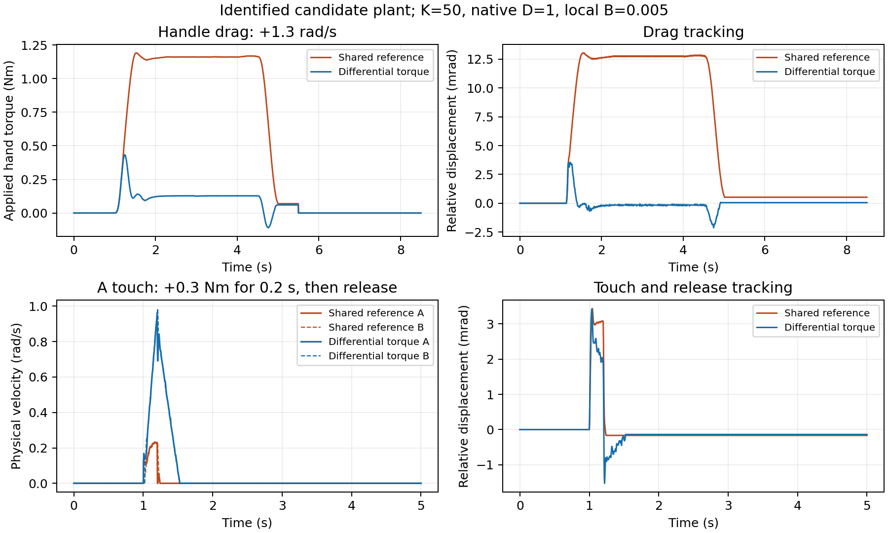

# 改进电机模型上的双边减阻

本轮只优化仿真双边力控，真机保持停机。保留辨识候选的电机惯量、摩擦、反馈动态及力矩平台，新增 `differential_torque`，消除共同运动中滞后位置参考引入的阻力。推荐仍为 K=50、Dc=0.4975、本地阻尼0.005、摩擦补偿比例0.6、每轴补偿上限0.2Nm；没有额外应用层总力矩预算。

## 控制律

令 `xA=qA-qA0`、`xB=d*(qB-qB0)`，`e=xA-xB+angle_offset`。主机以同一组最新反馈计算 `C_A=-K*e`、`C_B=-d*C_A`。两轴原生 MIT 的 Kp=0、Kd=2Dc+B；目标速度沿用共享模式的滤后共同速度，比例仍为 `2Dc/(2Dc+B)`。前馈由弹簧、摩擦、独立扰动和速度编码修正组成。

共同位置项从原生位置回路移出，两个连续弹簧力在共同方向相抵。通信延迟会影响相对运动，速度反馈延迟仍会产生动态阻力，但不会再将共同位置参考的滞后放大为 `2*K*delay*velocity` 量级的共同阻力。控制器只使用生产反馈，不读取仿真真值；真值仅用于外部手柄施力和评估。

MIT 前馈编码与实际电机仍有物理上限。弹簧接近编码余量时，两轴按共同系数缩小弹簧；原生阻尼保持完整。大角差不再因为 Kp=0 时无作用的位置目标越界而拒绝输出。正应用预算仍会共同缩小弹簧和原生阻尼以满足预算。`protocol_saturated` 独立报告限制，`gain_scale`不代表弹簧缩放比例。连续弹簧反向对称不代表量化后的两条 CAN 力矩严格相反。

默认共享参考模式及真机配置保持原样。新模式在节点获取会话前和 Dashboard 开始检查中均要求两轴为模拟电机，运行中的电机身份变化仍触发原有停机流程。

## 有传递时延的离线对照

使用生产 `VirtualMotor`、物理积分器、MIT 编解码、摩擦补偿器和新控制核心；控制500Hz、命令保持、反馈量化、双轴不同相位、因果发送与反馈队列均保留。名义发送/返回延迟各1ms、驱动错相1ms，基线持有位置参考的物理年龄均值约3.98ms。每次动作8.5s以内，撤去手柄后检查末1s的真实速度。

离线手柄施力为 `15*(q_handle-q)+0.05*(v_handle-v)` Nm，表中是其施加到轴上的净力矩，不是 Dashboard 的电机报告力矩。低速存在静摩擦停走，0.03rad/s是手柄速度，不应当作恒定电机实速。后述ROS试验使用另一种手柄定义，分别比较各自的前后结果。

| 手柄速度 rad/s | 共享参考净拖动力 Nm | 差模净拖动力 Nm |
| ---: | ---: | ---: |
| +0.03 | 0.2071 | 0.1277 |
| −0.03 | −0.1924 | −0.1188 |
| +0.20 | 0.2742 | 0.1038 |
| −0.20 | −0.2599 | −0.0940 |
| +1.30 | 1.1605 | 0.1273 |
| −1.30 | −1.1491 | −0.1168 |

快速正向拖动降幅约89%；同一手柄单独拖动失能A轴需要约0.1417Nm。名义快拖两轴实际速度均约1.300rad/s，没有用减慢运动来降低所需力矩。平均相对误差由12.74mrad降至−0.165mrad。剩余约0.1Nm摩擦、加速阶段的惯量感和量化误差仍然存在。

固定矩阵共88场：38场共享参考、38场差模、12场单轴失能对照。包含静止、A/B正反轻推后释放、正反拖动、往返、方向映射、K=50/80/100、单程0/1/2/4ms延迟、同步/错相发送，以及惯量和摩擦各±30%。这是选定工况的逐项扰动检查，并非所有参数的笛卡尔组合或全局稳定性证明。38场差模全部完成，末1s物理速度为0；这些场景没有触及弹簧协议余量，较大角差的编码限制另由核心测试覆盖。

在发送/返回各4ms时，快拖基线约2.7174Nm，差模约0.1189Nm；K=100名义快拖约2.1903→0.1146Nm。推荐配置暂保留K=50，以完整ROS对照的参数为准。

七个固定场景将物理步长从31.25µs减半，事件时间表不变。差模名义快拖平均力矩差约0.000073Nm，慢通信案例约0.00322Nm，所有停稳结论不变。自由共同位置对静摩擦和量化敏感，轻推轨迹绝对位置RMS差约0.8–1.3mrad；不能据此宣称逐点严格收敛或获得唯一真实物理参数。

低阻力并不等于立即停下。名义0.3Nm触碰释放时，差模轴速约0.988rad/s，约0.319s后持续低于0.02rad/s，共同位置继续移动约0.141rad；基线约0.0385s、0.00291rad。最慢为两轴真实摩擦降至标定值70%、补偿仍取原值60%的触碰案例：约1.3545s、0.844rad（48°）的共同滑行。这里“停稳时间”以2kHz记录中最后一次超过0.02rad/s之后的时刻计算，其后直到5s试验结束均保持低于阈值。该失配敏感性是后续实物验证前必须处理的动态手感局限，不能用末1s无振动掩盖。

## ROS实际节点对照

独立ROS域143、虚拟总线、同一电机模型和参数；冻结基线与最终候选只改变`control_mode`。两轮各包括A/B短触碰及A轴正反0.2/1.3rad/s拖动，每场开始静置2s，撤去输入后保持ACTIVE观察3s，再显式STOP。ROS手柄为`4*(anchor-q)-0.2*v`，输入有效期0.1s并持续刷新，4.5s拖动含0.25s平滑起步。

| 手柄速度 rad/s | 基线净拖动力 Nm | 差模净拖动力 Nm | 基线/差模相对误差RMS mrad |
| ---: | ---: | ---: | ---: |
| +0.2 | 0.3152 | 0.1054 | 3.086 / 0.888 |
| −0.2 | −0.3087 | −0.0975 | 2.805 / 0.844 |
| +1.3 | 1.4647 | 0.1156 | 14.401 / 2.177 |
| −1.3 | −1.5273 | −0.1057 | 14.820 / 1.006 |

稳态窗口为拖动末1.5s。两轮六场的释放末0.5s物理速度均为0，均取得新鲜双轴失能反馈。CAN观察丢帧计数为0，完整MotorFeedback计数无跳号、重复或回退；使用SimulationState源时钟对齐两轴后评分。这个约92–93%的快速拖动改善来自实际ROS/驱动/协议/模型链路，与上表离线试验分别成立。

另完成正反30°虚拟角差：2s过渡、5s保持，之后自动STOP并再次显式确认。实际相对位移分别−29.89856°、+29.90042°，尾段虚拟误差分别+0.10144°、−0.09958°，两轴尾速为0；原生P0/D1、增益比例1，没有协议饱和。两场几乎全部位移发生在B轴，A轴未实际转动。该控制律约束相对位置而放开共同坐标，摩擦不等时不保证两轴各转15°。

首次负角差START因测试器误读上一轮STOP前的IDLE快照，被控制器以busy拒绝，尚未使能或施加偏置。原失败保留；测试器改为等待控制器时间戳晚于STOP服务响应后，仅补执行未发生的负角差，成功确认。没有修改控制器参数或门限来通过测试。

## 未采用的方案

- 共同位置固定预测4ms：名义快拖减阻，但零附加通信延迟/同步采样的轻推测试发散，未加入正式控制器。
- 共同速度导数前馈：16ms提前量、32ms滤波在正拖、反拖、往返三场均发散；8ms提前量只能稍减加速力峰值，同时增大速度过冲，未保留参数或实现。

固定矩阵的代码包含恒等的零提前量调用；最终代码删除该实验类及调用，差模力矩计算保持不变。最终源码另通过项目内离线回归和ROS实际节点验证，避免把筛选原型的结果直接视作正式实现验收。

## 自动回归

新增[项目内离线基准](../test/offline_benchmark/README.md)，直接链接生产控制核心、电机模型和编解码器，不启动ROS或打开传输。默认10个短场景覆盖基线、差模、单轴失能、轻触、低延迟和半步长；`--full`可重跑固定88场矩阵。最终无提前量实现的10场短回归通过，与冻结矩阵对应场景的42个共有记录字段及事件时序逐位一致。

最终核心63项测试通过，包含新的方向/原点、虚拟角差、大分离下保留阻尼、协议编码、应用预算和恢复比例检查；另通过既有轻触、摩擦状态机、停机确认与带宽测试。Dashboard的72项API测试、9项launch测试通过；系统无Node，两份前端夹具及完整JS语法在V8执行通过。真实最终控制器加模拟消息的启动回归证明：非模拟身份在任何LEASE/ENABLE之前被拒绝，模拟身份可进入ACQUIRING，未授予会话时不会输出ENABLE或目标，结束均有新鲜STOP确认。

测试环境的首轮Python检查误加载了冻结基线的模块/裁剪配置，修正为最终隔离overlay及完整测试配置后通过，初始日志保留。模拟消息夹具曾因状态QoS配置不当未到达START，修正夹具并验证最终二进制，未放宽控制器要求。

## 使用与证据

使用[显式仿真配置](../../../config/bilateral_optimized_simulation_20261104.md)。电机模型与[辨识报告](2026-11-04-manual-identification.md)一致；没有因此消除其热模型、内部固件动态、未测外部手力等辨识局限。在线虚拟总线与显式延迟的离线试验时序不同，各自进行前后对照。

本机完整原始记录位于 `~/.ros/dm_motor_bilateral_control/stability-20261102/simulation-optimization-20261104/`：

- `bench/production-core/`：冻结源文件哈希、88场矩阵、7场半步长及6场速度前馈探索记录；早期概念筛选在上级`bench/`，不能替代生产核心结果。
- `core-change/`：修改前快照、最终核心测试、配置差异。
- `baseline-once/`：原ROS控制器的6场基线及完整消息、真实仿真状态、外部输入和CAN观察记录。
- `candidate-once/`、`candidate-negative-angle-completion/`、`angle-comparison/`：最终候选六场对照、正反角差及原失败来源。
- `runtime/`：隔离构建及候选控制器，独立ROS域、全虚拟设备；主工作区安装和真机进程未替换。

这些结果证明本次模型及测试条件下的减阻和停稳。尚未将新控制律部署到真机，也未完成新方案的现场手感验收。

结束时8184的候选仿真双轴有新鲜失能确认。真机四个进程及可执行文件身份未变，本轮未向其发送控制命令；只读8084检查发现真机反馈已中断约10分钟、驱动处于FAULT并报告位置连续性丢失，因此不能声称当时具有新鲜的真机失能确认。未重启、清错或重新使能，原因尚未确定；下一轮真机测试前须先恢复反馈。记录见`FINAL_READONLY_STATE.json`。
